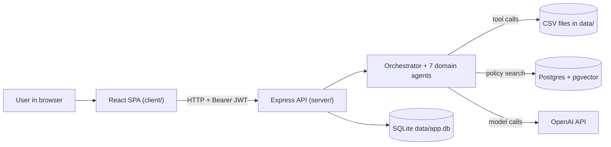

# Employee AI Assistant — Overview

> Documentation for commit `225654c` on branch `main`. Start here, then follow [01-READING-ORDER.md](01-READING-ORDER.md).

## What this project does

Employee AI Assistant is an internal HR chat app. A signed-in user asks questions in plain English ("what is my salary?", "who are the top performers?") and a team of LLM agents answers using company data stored in CSV files and the company's HR policy documents.

One **Orchestrator** agent reads each question and hands it to one of seven **domain agents** (employee, attendance, department, salary, performance, project, policy). Each domain agent can only answer by calling **tools**. Six of them read the CSVs. The seventh, the Policy Agent, searches the HR policy documents by meaning: the policies are split into passages, stored as vectors in Postgres, and the closest passages are retrieved for each question.

What a user may see depends on their **role** (`employee`, `manager`, `admin`). Employees see only their own salary, attendance, and performance. Managers and admins can ask company-wide salary questions, but those tool calls are **paused until a manager or admin approves them** on a dashboard.

Around the agents sit **guardrails**: checks that block off-topic or prompt-injection input, block answers that leak internals, and block answers that state facts no tool returned.

## Tech stack and why each piece is there

### Server (`server/`)

| Piece | Why it is here |
| --- | --- |
| Node.js + TypeScript (ESM), run with `tsx` | Runs `.ts` directly; there is no build step for the server ([server/package.json:7](../server/package.json#L7)). |
| Express 5 | HTTP API. v5 forwards rejected `async` handlers to the error handler, which the code relies on (see [09](09-ISSUES-AND-OPEN-QUESTIONS.md)). |
| `@openai/agents` (OpenAI Agents SDK) | Agents, handoffs, tools, guardrails, human-in-the-loop approvals, and tracing. The core of the app. |
| `zod` | Declares tool parameter schemas and the structured output schema the model must fill. |
| `node:sqlite` (built into Node) | Persists conversations, approvals, traces, and request logs in `data/app.db`. No DB server to install. |
| `csv-parser` | Reads the seed HR data in `data/*.csv`. |
| `pg` + PostgreSQL with the pgvector extension | Stores the HR policy passages and their embedding vectors, and finds the nearest ones to a question. Used only by policy search. |
| `openai` (the plain API client) | Creates embeddings with `text-embedding-3-small`. The agents themselves do not use it; the Agents SDK has its own client. |
| `jsonwebtoken` + `bcryptjs` | Login: bcrypt checks the password, a JWT carries identity and role for one hour. |
| `express-rate-limit` | Caps login attempts per IP and chat messages per user. |
| `cors` | Lets the React dev server (another origin) call the API. |
| `pino` | Structured JSON log line per HTTP request. |
| `swagger-jsdoc` + `swagger-ui-express` | Builds API docs from `@openapi` comments and serves them at `/api-docs`. |
| `dotenv` | Loads `server/.env` before anything else runs. |

### Client (`client/`)

| Piece | Why it is here |
| --- | --- |
| React 19 + TypeScript | The single-page app. |
| Vite 8 (+ React Compiler via Babel) | Dev server and bundler; the compiler auto-memoizes components ([client/vite.config.ts:9-13](../client/vite.config.ts#L9-L13)). |
| React Router 7 | `/login`, `/chat/:sessionId?`, `/approvals`, plus route guards. |
| Tailwind CSS v4 + shadcn/ui on Base UI | Styling and ready-made accessible primitives in `client/src/components/ui/`. |
| `react-markdown` + `remark-gfm` | Renders assistant replies (bold, lists, tables) without raw HTML. |
| `sonner` | Toast notifications. |
| `lucide-react` | Icons. |

## High-level picture



The full picture, with lifecycle, flows, state machines, and error paths, is in [03-ARCHITECTURE-AND-LIFECYCLE.md](03-ARCHITECTURE-AND-LIFECYCLE.md).

## Install, configure, run

### Prerequisites

- **Node.js 22.13 or newer.** The server imports the built-in `node:sqlite` module ([server/src/db/database.ts:3](../server/src/db/database.ts#L3)). The repo was last run on Node 26.
- An **OpenAI API key**.
- **PostgreSQL with the pgvector extension**, and an empty database for the app. Needed only for HR-policy questions; everything else works without it.

### Server environment variables

Create `server/.env`:

| Variable | Required | Used at | Purpose |
| --- | --- | --- | --- |
| `JWT_SECRET` | Yes | [server/src/services/auth.service.ts:16-20](../server/src/services/auth.service.ts#L16-L20) | Signs and verifies JWTs. The server throws at import time if it is missing. |
| `OPENAI_API_KEY` | Yes | Read by the Agents SDK itself, and at [server/src/config/openai.ts:3-5](../server/src/config/openai.ts#L3-L5) | Every agent and classifier call, and policy embeddings. The `openai` client throws at import time if it is missing. |
| `DATABASE_URL` | For policy questions | [server/src/db/vectorDb.ts:16-21](../server/src/db/vectorDb.ts#L16-L21) | Postgres connection string, for example `postgresql://user@localhost:5432/employee_ai_assistant`. Read on the first policy search, not at startup. |
| `PORT` | No (3000) | [server/src/server.ts:8](../server/src/server.ts#L8) | HTTP port. |
| `CLIENT_ORIGIN` | No (`http://localhost:5173`) | [server/src/app.ts:25-27](../server/src/app.ts#L25-L27) | Comma-separated CORS allowlist. |
| `LOG_LEVEL` | No (`info`) | [server/src/logging/logger.ts:4](../server/src/logging/logger.ts#L4) | pino log level. |
| `OPENAI_DEFAULT_MODEL` | No | Read by the Agents SDK | Overrides the SDK default model. No agent in this repo sets a model explicitly. |

### Client environment variables

| Variable | Required | Used at | Purpose |
| --- | --- | --- | --- |
| `VITE_API_URL` | No (`http://localhost:3000`) | [client/src/lib/api.ts:14-15](../client/src/lib/api.ts#L14-L15) | Base URL of the API. |

### Run

```bash
# terminal 1
cd server
npm install
npm run ingest:policies   # one-time, and after any policy edit: chunk, embed, write to Postgres
npm run dev          # http://localhost:3000, API docs at /api-docs

# terminal 2
cd client
npm install
npm run dev          # http://localhost:5173
```

`data/app.db` is created automatically on first server start. Seed users are in `data/users.csv`; `manager1` / `manager123` is the account confirmed in [client/TESTING.md](../client/TESTING.md).

`npm run ingest:policies -- --dry-run` prints the chunk boundaries without calling OpenAI or the database. If you skip ingestion, the app still runs; policy questions get an apology instead of an answer. See [04-modules/policy-knowledge.md](04-modules/policy-knowledge.md).

## Table of contents

| Doc | What it covers |
| --- | --- |
| [01-READING-ORDER.md](01-READING-ORDER.md) | The order to read source files in, with what to look for at each step |
| [02-FOLDER-STRUCTURE.md](02-FOLDER-STRUCTURE.md) | Annotated tree of every folder and important file |
| [03-ARCHITECTURE-AND-LIFECYCLE.md](03-ARCHITECTURE-AND-LIFECYCLE.md) | Diagrams: system context, components, startup, core flows, state machines, error flow |
| [05-CONCEPTS.md](05-CONCEPTS.md) | Libraries and patterns you may not know, and where each is used |
| [06-DATA-AND-STATE.md](06-DATA-AND-STATE.md) | CSV models, SQLite tables, the Postgres policy table, in-memory and browser state |
| [07-GLOSSARY.md](07-GLOSSARY.md) | Project-specific terms |
| [08-SELF-CHECK.md](08-SELF-CHECK.md) | Questions and hands-on exercises |
| [09-ISSUES-AND-OPEN-QUESTIONS.md](09-ISSUES-AND-OPEN-QUESTIONS.md) | Bugs, risky patterns, stale docs, things the code alone cannot answer |
| [CHANGELOG.md](CHANGELOG.md) | History of documentation updates |

### Module docs (`04-modules/`)

Server:

| Module | Doc |
| --- | --- |
| Server Bootstrap | [04-modules/server-bootstrap.md](04-modules/server-bootstrap.md) |
| Auth and Access Control | [04-modules/auth-and-access-control.md](04-modules/auth-and-access-control.md) |
| Chat API | [04-modules/chat-api.md](04-modules/chat-api.md) |
| Agent Runner | [04-modules/agent-runner.md](04-modules/agent-runner.md) |
| Agents | [04-modules/agents.md](04-modules/agents.md) |
| Tools | [04-modules/tools.md](04-modules/tools.md) |
| Guardrails | [04-modules/guardrails.md](04-modules/guardrails.md) |
| Approvals | [04-modules/approvals.md](04-modules/approvals.md) |
| Conversation Store | [04-modules/conversation-store.md](04-modules/conversation-store.md) |
| Domain Data | [04-modules/domain-data.md](04-modules/domain-data.md) |
| Policy Knowledge | [04-modules/policy-knowledge.md](04-modules/policy-knowledge.md) |
| Database | [04-modules/database.md](04-modules/database.md) |
| Observability | [04-modules/observability.md](04-modules/observability.md) |
| Dev Scripts | [04-modules/dev-scripts.md](04-modules/dev-scripts.md) |

Client:

| Module | Doc |
| --- | --- |
| Client App Shell | [04-modules/client-app-shell.md](04-modules/client-app-shell.md) |
| Client Auth | [04-modules/client-auth.md](04-modules/client-auth.md) |
| Client API Layer | [04-modules/client-api.md](04-modules/client-api.md) |
| Client Chat | [04-modules/client-chat.md](04-modules/client-chat.md) |
| Client Approvals | [04-modules/client-approvals.md](04-modules/client-approvals.md) |
| Client UI Kit | [04-modules/client-ui-kit.md](04-modules/client-ui-kit.md) |
