# Architecture and Lifecycle

The visual map of the application. Each section has a diagram followed by a numbered walkthrough that links to the code. Component names are the same in every diagram and match the files in [04-modules/](04-modules/).

Contents:

1. [System Context](#1-system-context)
2. [Architecture / Component Diagram](#2-architecture--component-diagram)
3. [Application Lifecycle](#3-application-lifecycle)
4. [Core Request / User Flows](#4-core-request--user-flows)
5. [State Transitions](#5-state-transitions)
6. [Error and Edge-Case Flow](#6-error-and-edge-case-flow)
7. [Deployment / Runtime View](#7-deployment--runtime-view)

---

## 1. System Context

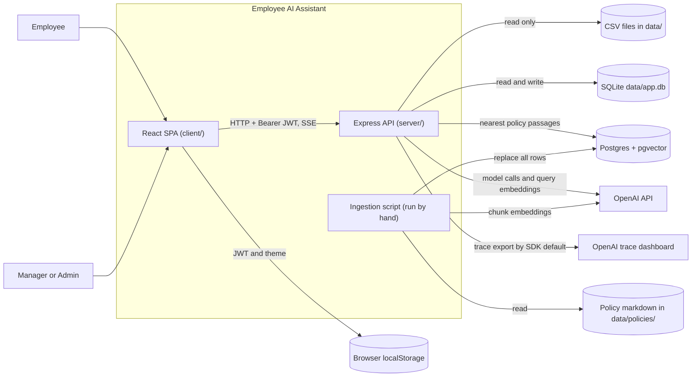

1. Two kinds of people use the app. Both chat; only managers and admins see the Approvals dashboard ([client/src/lib/roles.ts:7](../client/src/lib/roles.ts#L7)).
2. The SPA keeps exactly two things in the browser: the JWT ([client/src/lib/auth-storage.ts:24](../client/src/lib/auth-storage.ts#L24)) and the theme choice ([client/src/hooks/use-theme.ts:13](../client/src/hooks/use-theme.ts#L13)).
3. The SPA talks to one backend, the Express API, at `VITE_API_URL` ([client/src/lib/api.ts:14-15](../client/src/lib/api.ts#L14-L15)).
4. HR data is read from CSV files and never written ([server/src/services/csv.service.ts:13-36](../server/src/services/csv.service.ts#L13-L36)).
5. Everything the app itself produces (conversations, approvals, traces, request logs) goes to one SQLite file ([server/src/db/database.ts:11-13](../server/src/db/database.ts#L11-L13)).
6. HR policy text lives in a second database, Postgres with the pgvector extension, as passages with embedding vectors. The API only reads it ([server/src/services/knowledgeRetrieval.service.ts:67-74](../server/src/services/knowledgeRetrieval.service.ts#L67-L74)).
7. That database is filled by a separate program, the ingestion script, which reads the markdown files in `data/policies/` and is run by hand ([server/src/knowledge/ingest.ts:42-90](../server/src/knowledge/ingest.ts#L42-L90)). The API never reads the markdown files directly.
8. OpenAI is the only third-party service. The Agents SDK calls it for every agent turn and every guardrail classifier, reading `OPENAI_API_KEY` from the environment itself. Policy search and ingestion call its embeddings endpoint through a plain client ([server/src/knowledge/embedder.ts:13-16](../server/src/knowledge/embedder.ts#L13-L16)).
9. The SDK also exports traces to OpenAI's dashboard by default. The app adds its own processor next to that one rather than replacing it ([server/src/tracing/registerTracing.ts:6-13](../server/src/tracing/registerTracing.ts#L6-L13)).

There is no queue, no cache server, and no external auth provider.

---

## 2. Architecture / Component Diagram

### 2.1 Server

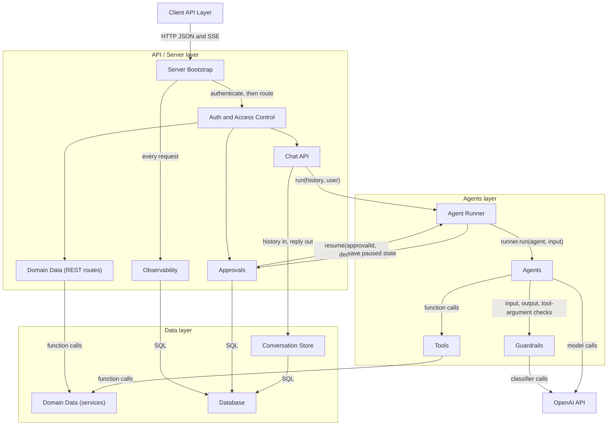

1. **Server Bootstrap** builds the Express app and decides middleware order: CORS, JSON body parsing, request logging, public routes, then `authenticate`, then protected routes ([server/src/app.ts:28-62](../server/src/app.ts#L28-L62)). See [server-bootstrap.md](04-modules/server-bootstrap.md).
2. **Observability** sees every request first because `httpLogger` is mounted before auth ([server/src/app.ts:33](../server/src/app.ts#L33)). It also receives every SDK trace event. See [observability.md](04-modules/observability.md).
3. **Auth and Access Control** verifies the JWT once, globally ([server/src/app.ts:50](../server/src/app.ts#L50)), then per-route role checks run ([server/src/middleware/authorize.ts:4-19](../server/src/middleware/authorize.ts#L4-L19)). See [auth-and-access-control.md](04-modules/auth-and-access-control.md).
4. **Chat API** validates a chat turn, reads and writes history through the **Conversation Store**, and asks the **Agent Runner** for an answer ([server/src/controllers/chat.controller.ts:122-173](../server/src/controllers/chat.controller.ts#L122-L173)). See [chat-api.md](04-modules/chat-api.md) and [conversation-store.md](04-modules/conversation-store.md).
5. **Agent Runner** is the only code that calls `runner.run`. It converts history to SDK input, runs the graph inside a trace, and turns the result into a `RunOutcome` ([server/src/orchestrator/runner.ts:103-134](../server/src/orchestrator/runner.ts#L103-L134)). See [agent-runner.md](04-modules/agent-runner.md).
6. **Agents** are the Orchestrator and seven domain specialists, wired together with handoffs ([server/src/agents/orchestrator.agent.ts:75-88](../server/src/agents/orchestrator.agent.ts#L75-L88)). See [agents.md](04-modules/agents.md).
7. **Guardrails** attach at three points: on the Orchestrator's input, on tool arguments, and on the final output ([server/src/orchestrator/runner.ts:33](../server/src/orchestrator/runner.ts#L33)). See [guardrails.md](04-modules/guardrails.md).
8. **Tools** are the only way an agent reaches data. Each calls a service function and returns a JSON string ([server/src/tools/salary.tool.ts:29-64](../server/src/tools/salary.tool.ts#L29-L64)). See [tools.md](04-modules/tools.md). One tool, `search_hr_policies`, goes to **Policy Knowledge** instead of Domain Data; that path is drawn separately in [2.3](#23-policy-knowledge) to keep this diagram readable.
9. **Domain Data** is used twice: by Tools and by plain REST routes. Both paths end in the same service functions over the same CSVs. See [domain-data.md](04-modules/domain-data.md).
10. **Approvals** has two jobs. The Runner writes a paused run into it; later the approvals controller reads it back and asks the Runner to resume ([server/src/controllers/approvals.controller.ts:48](../server/src/controllers/approvals.controller.ts#L48)). See [approvals.md](04-modules/approvals.md).
11. **Database** is one shared `DatabaseSync` handle imported by four stores ([server/src/db/database.ts:13](../server/src/db/database.ts#L13)). See [database.md](04-modules/database.md). Policy Knowledge does not use it; it has its own Postgres pool.

### 2.2 Client

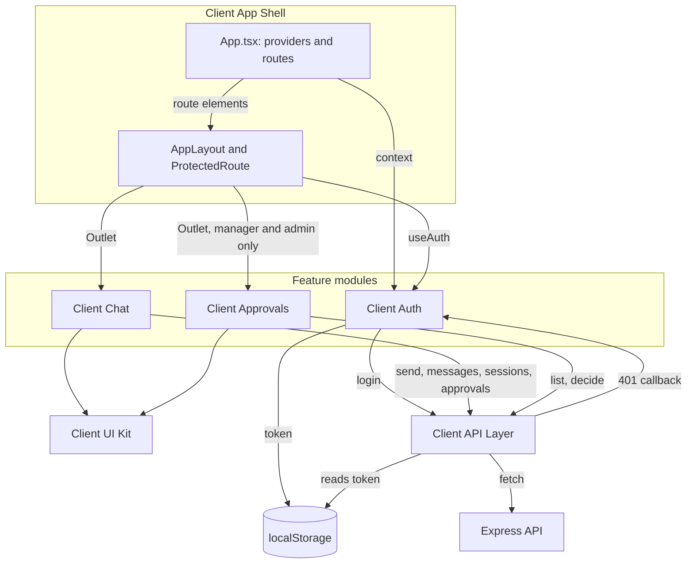

1. **Client App Shell** nests `ThemeProvider`, `BrowserRouter`, and `AuthProvider`, then declares the routes ([client/src/App.tsx:14-33](../client/src/App.tsx#L14-L33)). See [client-app-shell.md](04-modules/client-app-shell.md).
2. **Client Auth** owns the session. Pages read it through `useAuth` ([client/src/hooks/use-auth.ts:12-16](../client/src/hooks/use-auth.ts#L12-L16)). See [client-auth.md](04-modules/client-auth.md).
3. **Client API Layer** is the single place that calls `fetch`. It attaches the token and turns non-2xx responses into `ApiError` ([client/src/lib/api.ts:42-71](../client/src/lib/api.ts#L42-L71)). See [client-api.md](04-modules/client-api.md).
4. The API layer cannot import React, so auth registers a callback that fires on any 401 ([client/src/lib/api.ts:28-31](../client/src/lib/api.ts#L28-L31), [client/src/components/auth-provider.tsx:57-64](../client/src/components/auth-provider.tsx#L57-L64)).
5. **Client Chat** and **Client Approvals** are each one page plus one or two hooks. See [client-chat.md](04-modules/client-chat.md) and [client-approvals.md](04-modules/client-approvals.md).
6. **Client UI Kit** is generated shadcn code with no app logic. See [client-ui-kit.md](04-modules/client-ui-kit.md).

### 2.3 Policy Knowledge

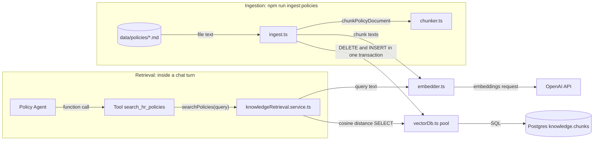

1. **Policy Knowledge** has an offline half and an online half that share two files: the embedder and the connection pool. See [policy-knowledge.md](04-modules/policy-knowledge.md).
2. Offline, `ingest.ts` reads each markdown file and passes it to the chunker, a pure function that returns section-sized chunks ([server/src/knowledge/ingest.ts:20-32](../server/src/knowledge/ingest.ts#L20-L32), [server/src/knowledge/chunker.ts:180-199](../server/src/knowledge/chunker.ts#L180-L199)).
3. It embeds every chunk, then replaces the table's contents inside one transaction ([server/src/knowledge/ingest.ts:52-82](../server/src/knowledge/ingest.ts#L52-L82)).
4. Online, the **Policy Agent** has exactly one tool ([server/src/agents/domains/policy.agent.ts:54-67](../server/src/agents/domains/policy.agent.ts#L54-L67)).
5. The tool calls the retrieval service and reshapes its result into JSON for the model ([server/src/tools/policy.tool.ts:22-39](../server/src/tools/policy.tool.ts#L22-L39)).
6. The service embeds the query with the same embedder and the same model, which is what makes query and chunk vectors comparable ([server/src/services/knowledgeRetrieval.service.ts:63](../server/src/services/knowledgeRetrieval.service.ts#L63)).
7. One SQL statement orders chunks by cosine distance to the query vector and returns the nearest four ([server/src/services/knowledgeRetrieval.service.ts:67-74](../server/src/services/knowledgeRetrieval.service.ts#L67-L74)).
8. The pool is created on first use from `DATABASE_URL` ([server/src/db/vectorDb.ts:13-40](../server/src/db/vectorDb.ts#L13-L40)).

---

## 3. Application Lifecycle

### 3.1 Server: startup

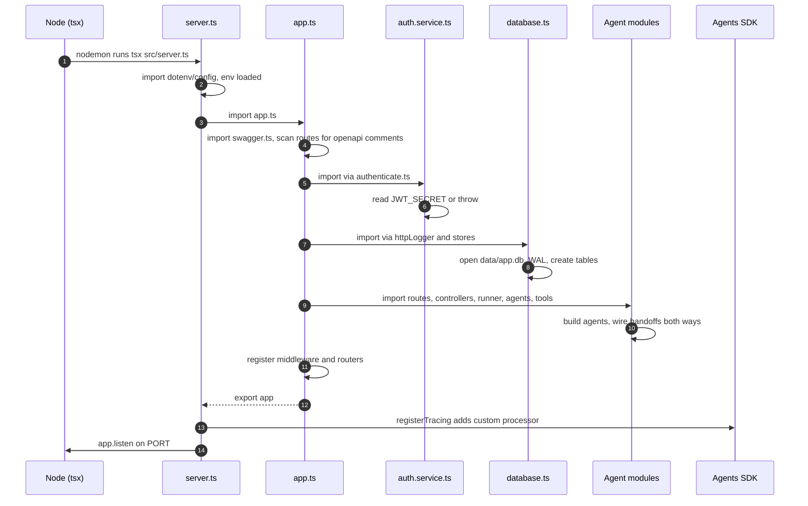

1. `npm run dev` starts nodemon, which runs `tsx src/server.ts` and restarts on any `.ts` change under `src/` ([server/package.json:7](../server/package.json#L7)).
2. The first import is `dotenv/config` ([server/src/server.ts:1](../server/src/server.ts#L1)). ES modules evaluate imports in order, so `.env` is loaded before any other module body runs.
3. Importing `app.ts` pulls in the whole server. Steps 4 to 10 all happen as side effects of that one import.
4. `swagger.ts` runs `swaggerJsdoc` at import time, which reads every file in `routes/` looking for `@openapi` comments ([server/src/openapi/swagger.ts:309-312](../server/src/openapi/swagger.ts#L309-L312)).
5. `authenticate.ts` imports `auth.service.ts`.
6. `auth.service.ts` evaluates the `JWT_SECRET` constant. If the variable is missing, the IIFE throws and the process dies before it listens ([server/src/services/auth.service.ts:16-20](../server/src/services/auth.service.ts#L16-L20)). This is intentional fail-fast.
7. `httpLogger.ts` imports `requestLogStore.ts`, which imports `database.ts`.
8. `database.ts` opens the file, sets WAL mode, and creates all six tables if they do not exist ([server/src/db/database.ts:13-84](../server/src/db/database.ts#L13-L84)). Each store then prepares its SQL statements at import time, for example [server/src/conversation/session.store.ts:10-53](../server/src/conversation/session.store.ts#L10-L53).
9. Route files import controllers, which import the runner, which imports the agents, which import the tools and guardrails.
10. Every `new Agent(...)` and `tool(...)` call runs now. `orchestrator.agent.ts` finishes by pushing the Orchestrator into each specialist's `handoffs` array ([server/src/agents/orchestrator.agent.ts:135-140](../server/src/agents/orchestrator.agent.ts#L135-L140)).
11. `app.ts` registers middleware and mounts routers in order ([server/src/app.ts:28-62](../server/src/app.ts#L28-L62)).
12. The configured app is the default export ([server/src/app.ts:64](../server/src/app.ts#L64)).
13. `registerTracing()` appends `StructuredLoggingProcessor` to the SDK's trace pipeline, guarded so it only happens once ([server/src/tracing/registerTracing.ts:9-13](../server/src/tracing/registerTracing.ts#L9-L13)).
14. `app.listen(PORT)` starts accepting connections ([server/src/server.ts:8-12](../server/src/server.ts#L8-L12)).

Nothing is fetched eagerly. CSV files are read on first use, not at startup ([server/src/services/csv.service.ts:17-19](../server/src/services/csv.service.ts#L17-L19)). The Postgres pool is not opened at startup either; it is created on the first policy search ([server/src/db/vectorDb.ts:13-14](../server/src/db/vectorDb.ts#L13-L14)), so a missing `DATABASE_URL` or an unreachable database does not stop the server from starting.

One more import-time effect arrived with policy search. Step 9's chain now reaches `config/openai.ts` (tools → `policy.tool.ts` → retrieval service → `embedder.ts`), which constructs an `OpenAI` client immediately ([server/src/config/openai.ts:3-5](../server/src/config/openai.ts#L3-L5)). That constructor throws when no API key is available, so a missing `OPENAI_API_KEY` now fails at startup instead of on the first chat message.

### 3.2 Server: what runs continuously

| What | Where | Notes |
| --- | --- | --- |
| HTTP listener | [server/src/server.ts:10](../server/src/server.ts#L10) | The only long-lived listener. |
| Rate-limit counters | [server/src/middleware/rateLimiters.ts:5-37](../server/src/middleware/rateLimiters.ts#L5-L37) | In memory. Reset on restart. |
| CSV cache | [server/src/services/csv.service.ts:11](../server/src/services/csv.service.ts#L11) | In memory. Never invalidated. |
| Postgres connection pool | [server/src/db/vectorDb.ts:25](../server/src/db/vectorDb.ts#L25) | Created on the first policy search, then kept for the life of the process. |
| SDK trace export | Agents SDK default processor | Batches and sends traces to OpenAI in the background. |
| nodemon file watcher | [server/package.json:7](../server/package.json#L7) | Dev only. |

There are no cron jobs, polling loops, workers, or subscriptions on the server. Pruning of old rows happens inline on each insert, for example [server/src/logging/requestLogStore.ts:70](../server/src/logging/requestLogStore.ts#L70).

### 3.3 Server: shutdown

Shutdown is **not handled**. There is no `SIGINT` or `SIGTERM` handler, `server.close()` is never called, the SQLite handle is never closed, the Postgres pool is never closed (`closeVectorDb` is only called by the ingestion script), and `StructuredLoggingProcessor.shutdown()` is an empty method ([server/src/tracing/structuredLoggingProcessor.ts:104](../server/src/tracing/structuredLoggingProcessor.ts#L104)). In-flight chat requests are cut off when the process exits. Listed in [09](09-ISSUES-AND-OPEN-QUESTIONS.md#missing-error-handling).

### 3.4 Client: startup

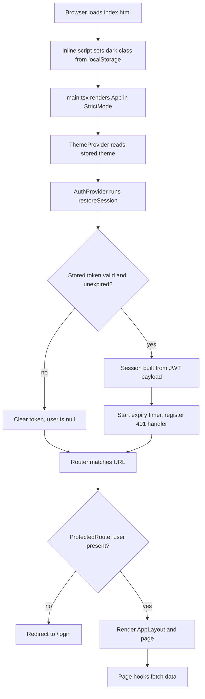

1. `index.html` runs a small script before any bundle loads. It applies the saved theme so there is no flash of the wrong one ([client/index.html:8-22](../client/index.html#L8-L22)).
2. `main.tsx` mounts `<App />` inside `StrictMode` ([client/src/main.tsx:6-10](../client/src/main.tsx#L6-L10)). In development, StrictMode runs effects twice, which is why every effect in this app cleans up with an `AbortController`.
3. `ThemeProvider` reads the stored theme and subscribes to the OS colour scheme ([client/src/components/theme-provider.tsx:37-50](../client/src/components/theme-provider.tsx#L37-L50)).
4. `AuthProvider` initialises its state by calling `restoreSession` once ([client/src/components/auth-provider.tsx:41](../client/src/components/auth-provider.tsx#L41)).
5. `restoreSession` decodes the stored JWT. A missing, malformed, or expired token is cleared and the user starts signed out ([client/src/components/auth-provider.tsx:29-38](../client/src/components/auth-provider.tsx#L29-L38)).
6. With a session, two effects start: a `setTimeout` that logs the user out at the token's expiry time ([client/src/components/auth-provider.tsx:68-77](../client/src/components/auth-provider.tsx#L68-L77)), and registration of the global 401 handler ([client/src/components/auth-provider.tsx:57-64](../client/src/components/auth-provider.tsx#L57-L64)).
7. The router matches the URL. Anything unknown redirects to `/chat` ([client/src/App.tsx:28](../client/src/App.tsx#L28)).
8. `ProtectedRoute` redirects to `/login` when there is no user, and to `/chat` when the role is not allowed ([client/src/components/protected-route.tsx:17-22](../client/src/components/protected-route.tsx#L17-L22)).
9. The page mounts and its hooks fetch: the session list ([client/src/hooks/use-chat-sessions.ts:14-29](../client/src/hooks/use-chat-sessions.ts#L14-L29)) and, for a saved chat, its transcript and approvals ([client/src/hooks/use-chat.ts:68-96](../client/src/hooks/use-chat.ts#L68-L96)).

### 3.5 Client: what runs continuously

| What | Interval | Where | Runs when |
| --- | --- | --- | --- |
| Token expiry timer | Once, at `exp` | [client/src/components/auth-provider.tsx:71-75](../client/src/components/auth-provider.tsx#L71-L75) | A session exists |
| OS theme listener | Event | [client/src/components/theme-provider.tsx:30-34](../client/src/components/theme-provider.tsx#L30-L34) | Always |
| Approval decision poll | 4 s | [client/src/hooks/use-chat.ts:102-135](../client/src/hooks/use-chat.ts#L102-L135) | The open chat has a pending approval |
| Pending approvals poll | 15 s | [client/src/hooks/use-approvals.ts:22-47](../client/src/hooks/use-approvals.ts#L22-L47) | The Approvals page is mounted |

### 3.6 Client: teardown

Every effect returns a cleanup that clears its timer and aborts its request. Unmounting `ChatView` aborts an in-flight `POST /chat` ([client/src/hooks/use-chat.ts:137](../client/src/hooks/use-chat.ts#L137)). Logout clears the token and state ([client/src/components/auth-provider.tsx:43-46](../client/src/components/auth-provider.tsx#L43-L46)). There is no server-side logout; the JWT stays valid until it expires.

### 3.7 Ingestion script lifecycle

The third runnable part. It starts, does one job, and exits.

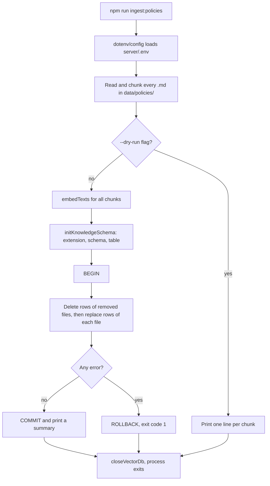

1. The npm script runs `tsx src/knowledge/ingest.ts` ([server/package.json:8](../server/package.json#L8)).
2. `dotenv/config` is the first import, because `config/openai.ts` reads the key while it is being imported ([server/src/knowledge/ingest.ts:5-7](../server/src/knowledge/ingest.ts#L5-L7)).
3. Every `.md` file is read and chunked. An empty folder or a document that yields no chunks stops the run ([server/src/knowledge/ingest.ts:20-32](../server/src/knowledge/ingest.ts#L20-L32)).
4. `--dry-run` prints the chunk list and returns without any network call ([server/src/knowledge/ingest.ts:45-48](../server/src/knowledge/ingest.ts#L45-L48)).
5. All embeddings are fetched before the database is touched, so an API failure cannot leave the table half-written ([server/src/knowledge/ingest.ts:50-52](../server/src/knowledge/ingest.ts#L50-L52)).
6. The schema is created if missing. This is the only place it is created ([server/src/db/knowledgeSchema.ts:16-34](../server/src/db/knowledgeSchema.ts#L16-L34)).
7. One transaction removes chunks of files that no longer exist, then deletes and re-inserts the chunks of every current file ([server/src/knowledge/ingest.ts:58-82](../server/src/knowledge/ingest.ts#L58-L82)).
8. Any error rolls the transaction back and sets a non-zero exit code ([server/src/knowledge/ingest.ts:84-96](../server/src/knowledge/ingest.ts#L84-L96)).
9. `closeVectorDb` always runs. Without it the open pool would keep the process alive ([server/src/knowledge/ingest.ts:97](../server/src/knowledge/ingest.ts#L97), [server/src/db/vectorDb.ts:42-49](../server/src/db/vectorDb.ts#L42-L49)).

Nothing runs continuously here, and a running API server does not need a restart after ingestion: the next search simply reads the new rows.

---

## 4. Core Request / User Flows

### 4.1 User logs in

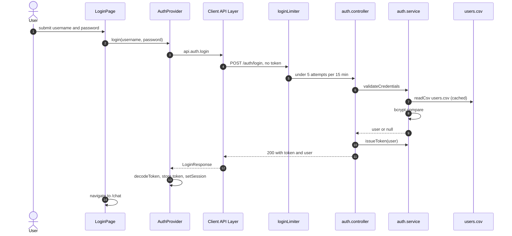

1. The form handler prevents the default submit and trims the username ([client/src/pages/login-page.tsx:30-36](../client/src/pages/login-page.tsx#L30-L36)).
2. It calls `login` from the auth context ([client/src/components/auth-provider.tsx:48-54](../client/src/components/auth-provider.tsx#L48-L54)).
3. That calls the API layer with `auth: false`, so no `Authorization` header is sent and a 401 here does not trigger the "session expired" logout ([client/src/lib/api.ts:90-95](../client/src/lib/api.ts#L90-L95)).
4. On the server the request passes CORS, JSON parsing, and the logger, then reaches the public `/auth` router ([server/src/app.ts:42](../server/src/app.ts#L42)).
5. `loginLimiter` counts attempts per IP. The sixth attempt in 15 minutes gets a 429 ([server/src/middleware/rateLimiters.ts:5-19](../server/src/middleware/rateLimiters.ts#L5-L19), [server/src/routes/auth.route.ts:52](../server/src/routes/auth.route.ts#L52)).
6. The controller checks that both fields are strings, else 400 ([server/src/controllers/auth.controller.ts:7-11](../server/src/controllers/auth.controller.ts#L7-L11)).
7. `validateCredentials` loads users from the CSV ([server/src/services/auth.service.ts:35-45](../server/src/services/auth.service.ts#L35-L45)). The CSV is cached after the first read.
8. `bcrypt.compare` checks the password against the stored hash ([server/src/services/auth.service.ts:43](../server/src/services/auth.service.ts#L43)).
9. No user or a wrong password both return `null`, and the controller answers 401 with one generic message so it does not reveal which was wrong ([server/src/controllers/auth.controller.ts:14-18](../server/src/controllers/auth.controller.ts#L14-L18)).
10. `issueToken` signs a JWT containing `userId`, `employeeId`, `username`, and `role`, valid for one hour ([server/src/services/auth.service.ts:47-55](../server/src/services/auth.service.ts#L47-L55)).
11. The response carries the token and a user object without the password hash ([server/src/controllers/auth.controller.ts:20-30](../server/src/controllers/auth.controller.ts#L20-L30)).
12. The API layer returns parsed JSON ([client/src/lib/api.ts:83-86](../client/src/lib/api.ts#L83-L86)).
13. `AuthProvider` ignores the `user` object in the response. It decodes the token and builds the session from that, so there is one source of truth ([client/src/components/auth-provider.tsx:49-53](../client/src/components/auth-provider.tsx#L49-L53)).
14. The page navigates to `/chat` ([client/src/pages/login-page.tsx:37](../client/src/pages/login-page.tsx#L37)).

### 4.2 User sends a chat message

This is the HTTP-level view of a normal turn in the default text mode. What happens inside step 9 is expanded in [4.3](#43-inside-one-agent-run).

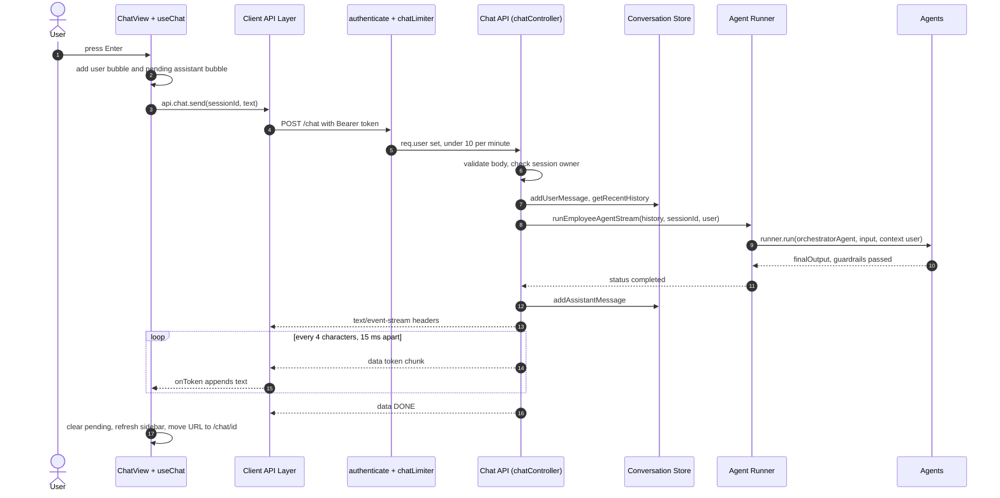

1. Enter without Shift submits the draft ([client/src/pages/chat-page.tsx:140-154](../client/src/pages/chat-page.tsx#L140-L154)).
2. `send` optimistically appends two messages: the user's text and an empty assistant message marked `pending` ([client/src/hooks/use-chat.ts:144-148](../client/src/hooks/use-chat.ts#L144-L148)). The pending one renders as a skeleton ([client/src/components/chat/message-bubble.tsx:27-33](../client/src/components/chat/message-bubble.tsx#L27-L33)).
3. It calls the API layer with the session id. For a new chat this is a UUID generated when the hook mounted ([client/src/hooks/use-chat.ts:43-44](../client/src/hooks/use-chat.ts#L43-L44)).
4. `sendChat` posts `{ sessionId, message }` with no `format`, which selects text mode ([client/src/lib/api.ts:118-122](../client/src/lib/api.ts#L118-L122)).
5. `authenticate` verifies the token ([server/src/middleware/authenticate.ts:14-23](../server/src/middleware/authenticate.ts#L14-L23)). `chatLimiter` allows 10 posts per minute per `userId` ([server/src/middleware/rateLimiters.ts:25-37](../server/src/middleware/rateLimiters.ts#L25-L37), [server/src/routes/chat.route.ts:58](../server/src/routes/chat.route.ts#L58)).
6. The controller validates in order: non-empty strings, a legal `format`, a UUID session id, and ownership. A session that exists and belongs to someone else is a 403. A session that does not exist yet is fine ([server/src/controllers/chat.controller.ts:89-120](../server/src/controllers/chat.controller.ts#L89-L120)).
7. The user message is saved first, then the last 20 messages are read back, so the new message is part of the history ([server/src/controllers/chat.controller.ts:123-124](../server/src/controllers/chat.controller.ts#L123-L124), [server/src/conversation/conversation.service.ts:5](../server/src/conversation/conversation.service.ts#L5)). The first write to a session id also creates its `sessions` row and so claims ownership ([server/src/conversation/session.store.ts:91-100](../server/src/conversation/session.store.ts#L91-L100)).
8. The controller awaits the runner ([server/src/controllers/chat.controller.ts:173](../server/src/controllers/chat.controller.ts#L173)).
9. The runner converts history to SDK items, opens a trace grouped by session id, and runs the Orchestrator with the authenticated user as `context` ([server/src/orchestrator/runner.ts:108-116](../server/src/orchestrator/runner.ts#L108-L116)).
10. The SDK returns only after the whole agent graph and all output guardrails have finished.
11. A non-empty answer becomes `{ status: "completed", output }`. An empty one is retried once ([server/src/orchestrator/runner.ts:120-126](../server/src/orchestrator/runner.ts#L120-L126)).
12. The controller refuses to save or send a blank answer (502), then saves the assistant message ([server/src/controllers/chat.controller.ts:197-210](../server/src/controllers/chat.controller.ts#L197-L210)).
13. Only now are SSE headers sent ([server/src/controllers/chat.controller.ts:212-215](../server/src/controllers/chat.controller.ts#L212-L215)).
14. The finished text is cut into 4-character chunks and written as `data: {"token":"..."}` events with a 15 ms pause between them ([server/src/controllers/chat.controller.ts:217-221](../server/src/controllers/chat.controller.ts#L217-L221)). This is a replay for a typing effect, not live model streaming.
15. The client sees `Content-Type: text/event-stream`, reads the body as a stream, splits on blank lines, and calls `onToken` per event ([client/src/lib/api.ts:124-125](../client/src/lib/api.ts#L124-L125), [client/src/lib/api.ts:153-181](../client/src/lib/api.ts#L153-L181)). The first token flips `pending` to false ([client/src/hooks/use-chat.ts:162-169](../client/src/hooks/use-chat.ts#L162-L169)).
16. `data: [DONE]` ends the stream on both sides ([server/src/controllers/chat.controller.ts:223-224](../server/src/controllers/chat.controller.ts#L223-L224), [client/src/lib/api.ts:174](../client/src/lib/api.ts#L174)).
17. `send` sets `started`, and its `finally` calls `onActivity` so the sidebar refetches ([client/src/hooks/use-chat.ts:172](../client/src/hooks/use-chat.ts#L172), [client/src/hooks/use-chat.ts:210-213](../client/src/hooks/use-chat.ts#L210-L213)). For a new chat, an effect then replaces the URL with `/chat/<id>` and passes the current messages along as a seed ([client/src/pages/chat-page.tsx:129-136](../client/src/pages/chat-page.tsx#L129-L136)).

**Why replay instead of real streaming?** Output guardrails need the complete answer. If tokens were streamed live, a leaked secret or an invented number would already be on screen by the time a guardrail tripped.

### 4.3 Inside one agent run

Example: an employee asks "what is my salary?".

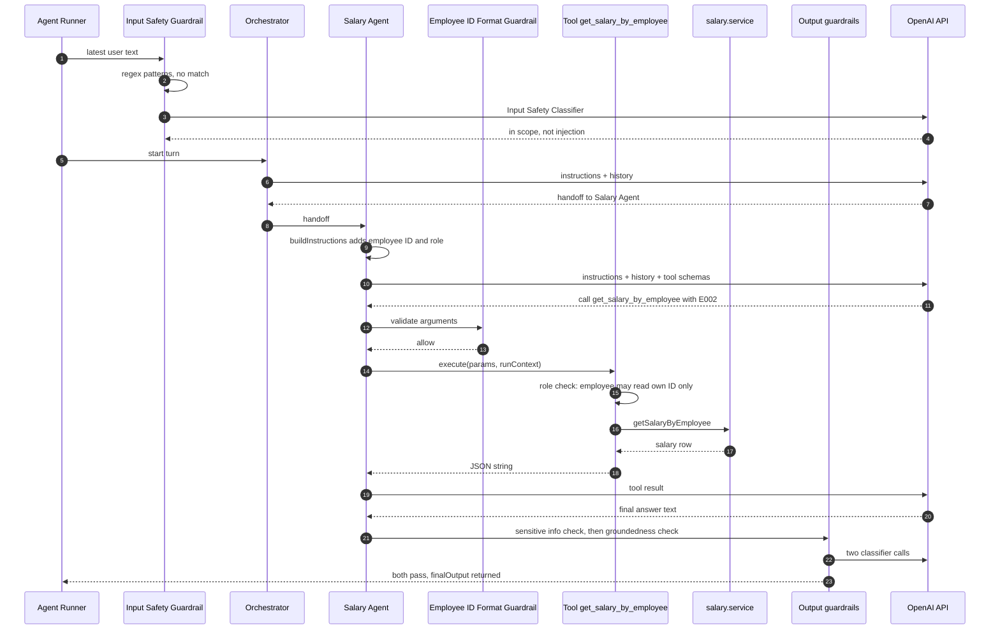

1. Input guardrails belong to the Orchestrator, which is always the starting agent ([server/src/agents/orchestrator.agent.ts:78](../server/src/agents/orchestrator.agent.ts#L78)). `runInParallel: false` means the Orchestrator's own model call waits for this check ([server/src/guardrails/inputSafety.guardrail.ts:92](../server/src/guardrails/inputSafety.guardrail.ts#L92)).
2. The latest user message is tested against ten injection regexes. A match trips immediately with no model call ([server/src/guardrails/inputSafety.guardrail.ts:14-25](../server/src/guardrails/inputSafety.guardrail.ts#L14-L25), [server/src/guardrails/inputSafety.guardrail.ts:99-109](../server/src/guardrails/inputSafety.guardrail.ts#L99-L109)).
3. Otherwise a small classifier agent returns `isOutOfScope` and `isInjectionAttempt` ([server/src/guardrails/inputSafety.guardrail.ts:113-120](../server/src/guardrails/inputSafety.guardrail.ts#L113-L120)).
4. Either flag being true throws `InputGuardrailTripwireTriggered` out of `runner.run`. See [section 6](#6-error-and-edge-case-flow).
5. The Orchestrator has no tools. Its instructions tell it to hand off or ask a clarifying question ([server/src/agents/orchestrator.agent.ts:30-73](../server/src/agents/orchestrator.agent.ts#L30-L73)).
6. The SDK exposes each entry in `handoffs` to the model as a callable transfer function.
7. The model picks the Salary Agent.
8. Control moves to the Salary Agent within the same run. The conversation so far goes with it.
9. The Salary Agent's instructions are a function. It appends a note with the caller's employee ID and role so "my salary" resolves without asking ([server/src/agents/domains/salary.agent.ts:42-50](../server/src/agents/domains/salary.agent.ts#L42-L50)).
10. The model sees the tool list declared for this agent ([server/src/agents/domains/salary.agent.ts:56-61](../server/src/agents/domains/salary.agent.ts#L56-L61)).
11. The model asks to call `get_salary_by_employee`.
12. Before execution, the tool's input guardrail checks the argument against `^E\d{3,}$` ([server/src/guardrails/validators.ts:1-9](../server/src/guardrails/validators.ts#L1-L9), [server/src/guardrails/toolMisuse.guardrail.ts:46-49](../server/src/guardrails/toolMisuse.guardrail.ts#L46-L49)).
13. A bad ID returns `rejectContent`: the tool does not run and the model receives the error text instead ([server/src/guardrails/toolMisuse.guardrail.ts:30-38](../server/src/guardrails/toolMisuse.guardrail.ts#L30-L38)).
14. This tool has no `needsApproval`, so it executes straight away. The second argument is the run context that carries the user ([server/src/tools/salary.tool.ts:37-42](../server/src/tools/salary.tool.ts#L37-L42)).
15. The role check is plain code: an employee asking for someone else's ID gets an error string back ([server/src/tools/salary.tool.ts:43-51](../server/src/tools/salary.tool.ts#L43-L51)).
16. The service filters the cached CSV rows ([server/src/services/salary.service.ts:16-19](../server/src/services/salary.service.ts#L16-L19)).
17. The row comes back.
18. Tools always return a string. Objects are `JSON.stringify`'d ([server/src/tools/salary.tool.ts:61](../server/src/tools/salary.tool.ts#L61)). Any thrown error is caught by `safeToolExecute` and also returned as a JSON string ([server/src/utils/safeToolExecute.ts:10-19](../server/src/utils/safeToolExecute.ts#L10-L19)).
19. The SDK sends the tool result back to the model.
20. The model writes the final answer. If the question had been partly out of the Salary Agent's domain, it could instead hand back to the Orchestrator ([server/src/agents/shared/instructionFragments.ts:31-41](../server/src/agents/shared/instructionFragments.ts#L31-L41)).
21. Output guardrails are configured on the `Runner`, so they apply to whichever agent produced the final output ([server/src/orchestrator/runner.ts:33](../server/src/orchestrator/runner.ts#L33), [server/src/orchestrator/runner.ts:40-43](../server/src/orchestrator/runner.ts#L40-L43)).
22. The sensitive-info guardrail runs regexes and a tool-name scan, then a classifier ([server/src/guardrails/sensitiveInfo.guardrail.ts:77-95](../server/src/guardrails/sensitiveInfo.guardrail.ts#L77-L95)). The hallucination guardrail compares the answer with the tool results from this run ([server/src/guardrails/hallucination.guardrail.ts:80-110](../server/src/guardrails/hallucination.guardrail.ts#L80-L110)).
23. If neither trips, `runner.run` resolves with `finalOutput`.

A single user message therefore costs at least five model calls: input classifier, Orchestrator, specialist (tool call), specialist (answer), and two output classifiers.

### 4.4 Sensitive tool call: pause, approve, resume

Example: `manager1` asks "what is the average salary?" and `manager2` approves.

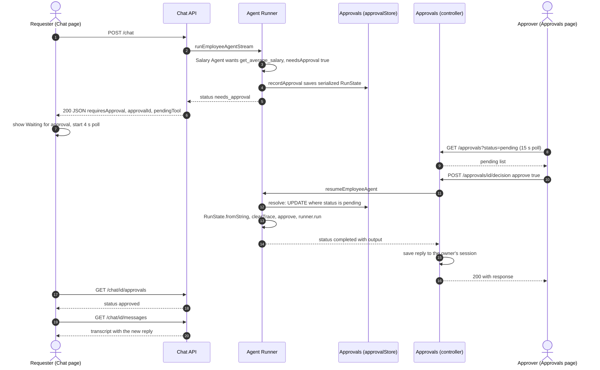

1. The turn starts exactly like [4.2](#42-user-sends-a-chat-message).
2. Same runner entry point.
3. The tool declares `needsApproval: needsApprovalUnlessEmployee` ([server/src/tools/salary.tool.ts:81-94](../server/src/tools/salary.tool.ts#L81-L94)). For a manager this returns `true` ([server/src/tools/roleAccess.ts:37-41](../server/src/tools/roleAccess.ts#L37-L41)). The SDK stops the run **before** executing the tool and returns a result whose `interruptions` array is not empty.
4. `recordApproval` generates an id and stores the tool name, arguments, agent name, the response format, and `result.state.toString()`, which is the entire run serialized ([server/src/orchestrator/runner.ts:65-101](../server/src/orchestrator/runner.ts#L65-L101), [server/src/approvals/approvalStore.ts:89-103](../server/src/approvals/approvalStore.ts#L89-L103)).
5. The runner returns `needs_approval` ([server/src/orchestrator/runner.ts:117-119](../server/src/orchestrator/runner.ts#L117-L119)).
6. The controller responds with plain JSON, never SSE. No assistant message is saved ([server/src/controllers/chat.controller.ts:189-191](../server/src/controllers/chat.controller.ts#L189-L191), [server/src/controllers/chat.controller.ts:54-66](../server/src/controllers/chat.controller.ts#L54-L66)).
7. The client detects the JSON content type and the `requiresApproval` flag ([client/src/lib/api.ts:132-138](../client/src/lib/api.ts#L132-L138)). The hook removes the pending bubble and adds a `WaitingApproval` ([client/src/hooks/use-chat.ts:173-183](../client/src/hooks/use-chat.ts#L173-L183)). A non-empty `waiting` list starts the poll ([client/src/hooks/use-chat.ts:102-106](../client/src/hooks/use-chat.ts#L102-L106)).
8. The approver's page loads pending approvals and repeats every 15 seconds ([client/src/hooks/use-approvals.ts:25-47](../client/src/hooks/use-approvals.ts#L25-L47)). The route requires manager or admin ([server/src/routes/approvals.route.ts:46](../server/src/routes/approvals.route.ts#L46)).
9. The list never includes `serializedState`; `summarize` strips it ([server/src/approvals/approvalStore.ts:28-31](../server/src/approvals/approvalStore.ts#L28-L31)).
10. Approve posts `{ approve: true }`. Reject opens a dialog for an optional reason first ([client/src/hooks/use-approvals.ts:49-58](../client/src/hooks/use-approvals.ts#L49-L58), [client/src/components/approvals/reject-dialog.tsx:69-74](../client/src/components/approvals/reject-dialog.tsx#L69-L74)).
11. The controller checks the body, that the approval exists (404), and that it is still pending (409), then calls the runner ([server/src/controllers/approvals.controller.ts:24-48](../server/src/controllers/approvals.controller.ts#L24-L48)).
12. The runner claims the approval with a conditional `UPDATE ... WHERE status = 'pending'`. If two approvers click at once, only one update changes a row; the other gets `not_found` and stops ([server/src/orchestrator/runner.ts:181-188](../server/src/orchestrator/runner.ts#L181-L188), [server/src/approvals/approvalStore.ts:61-64](../server/src/approvals/approvalStore.ts#L61-L64)).
13. The run is rebuilt from the string using the same root agent variant that started it, detached from its old closed trace, each interruption is approved or rejected, and the run continues ([server/src/orchestrator/runner.ts:194-230](../server/src/orchestrator/runner.ts#L194-L230)). On approve the tool now executes. On reject the model receives the rejection message and writes a reply about it.
14. The outcome is `completed`, or `needs_approval` again if the resumed run reached another sensitive tool ([server/src/orchestrator/runner.ts:231-235](../server/src/orchestrator/runner.ts#L231-L235)).
15. The controller writes the reply into the session, attributed to the session's owner rather than to the approver ([server/src/controllers/approvals.controller.ts:76-87](../server/src/controllers/approvals.controller.ts#L76-L87)).
16. The approver gets the output too, and their row is removed locally ([client/src/hooks/use-approvals.ts:59-63](../client/src/hooks/use-approvals.ts#L59-L63)).
17. The requester's next poll hits the owner-only endpoint ([server/src/controllers/chat.controller.ts:284-288](../server/src/controllers/chat.controller.ts#L284-L288)).
18. The approval is no longer pending, so the hook shows a toast ([client/src/hooks/use-chat.ts:109-121](../client/src/hooks/use-chat.ts#L109-L121)).
19. It reloads the transcript, because the reply only exists on the server ([client/src/hooks/use-chat.ts:122-125](../client/src/hooks/use-chat.ts#L122-L125)).
20. The transcript endpoint returns full history ([server/src/controllers/chat.controller.ts:275-279](../server/src/controllers/chat.controller.ts#L275-L279)).

An **employee** asking the same question never reaches step 4. `needsApprovalUnlessEmployee` returns `false` for them, the tool executes immediately, and `denyEmployees` returns a permission error ([server/src/tools/roleAccess.ts:45-54](../server/src/tools/roleAccess.ts#L45-L54)). This prevents employees from queuing approval requests for data they may never see.

### 4.5 Policy question (retrieval)

Example: "How many sick days do contract employees get?" The HTTP-level steps are the same as [4.2](#42-user-sends-a-chat-message); this is what replaces the CSV lookup inside the run.

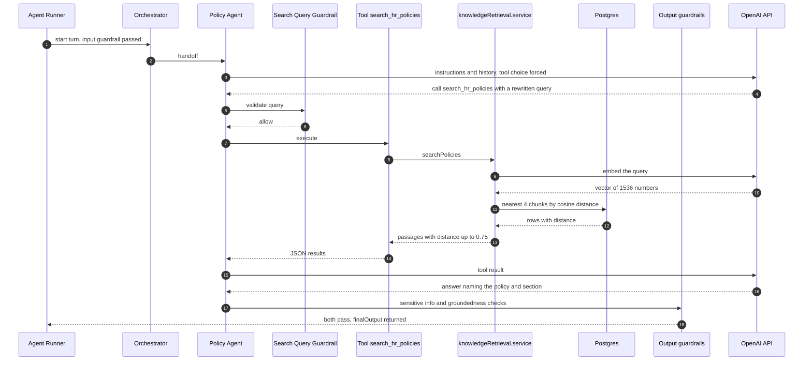

1. The input guardrail's classifier now treats questions about what the policies say as in scope ([server/src/guardrails/inputSafety.guardrail.ts:72-77](../server/src/guardrails/inputSafety.guardrail.ts#L72-L77)).
2. The Orchestrator separates rules from records: "how many sick days do contract employees get?" goes to the Policy Agent, "how many days has Priya taken off?" goes to a data specialist ([server/src/agents/orchestrator.agent.ts:52-57](../server/src/agents/orchestrator.agent.ts#L52-L57)).
3. The Policy Agent is configured with `toolChoice` set to its search tool, so its first model turn must be a tool call ([server/src/agents/domains/policy.agent.ts:61-66](../server/src/agents/domains/policy.agent.ts#L61-L66)). The comment records why: with instructions alone, the model skipped the search on about 60% of follow-up questions.
4. The model writes the query. The instructions ask for a short, self-contained one, not the user's literal words ([server/src/agents/domains/policy.agent.ts:15-21](../server/src/agents/domains/policy.agent.ts#L15-L21)).
5. The tool input guardrail requires a non-empty string of at most 500 characters ([server/src/guardrails/validators.ts:18-28](../server/src/guardrails/validators.ts#L18-L28), [server/src/guardrails/toolMisuse.guardrail.ts:56-59](../server/src/guardrails/toolMisuse.guardrail.ts#L56-L59)).
6. A rejection would be returned to the model as text, as in flow 4.3.
7. There is no `needsApproval` and no role check. Policy text is open to every role ([server/src/tools/policy.tool.ts:7-22](../server/src/tools/policy.tool.ts#L7-L22)).
8. The tool calls the service with defaults: four results, cutoff 0.75 ([server/src/tools/policy.tool.ts:23](../server/src/tools/policy.tool.ts#L23), [server/src/services/knowledgeRetrieval.service.ts:16-25](../server/src/services/knowledgeRetrieval.service.ts#L16-L25)).
9. The query is embedded with the same model used at ingestion ([server/src/services/knowledgeRetrieval.service.ts:63](../server/src/services/knowledgeRetrieval.service.ts#L63)).
10. The vector comes back from the embeddings endpoint. This call is not part of the SDK trace.
11. One SQL statement computes `embedding <=> query` for every chunk, filters to the current embedding model, and takes the smallest four ([server/src/services/knowledgeRetrieval.service.ts:67-74](../server/src/services/knowledgeRetrieval.service.ts#L67-L74)).
12. Postgres scans all rows; there is no vector index at this size ([server/src/db/knowledgeSchema.ts:13-15](../server/src/db/knowledgeSchema.ts#L13-L15)).
13. Rows above the cutoff are dropped and one `policy_search` log line is written with counts and distances, never the query text ([server/src/services/knowledgeRetrieval.service.ts:76-87](../server/src/services/knowledgeRetrieval.service.ts#L76-L87)).
14. The tool returns `policy`, `policyId`, `version`, `sections`, and `text` for each passage, or an empty list with a note ([server/src/tools/policy.tool.ts:24-38](../server/src/tools/policy.tool.ts#L24-L38)).
15. After a tool has run, the SDK resets tool choice to automatic, so the next model turn may answer, search again, or hand back.
16. The answer must rest only on the passages, name the policy, and say plainly when the documents do not cover the question ([server/src/agents/domains/policy.agent.ts:23-42](../server/src/agents/domains/policy.agent.ts#L23-L42)).
17. The same two output guardrails run. The groundedness classifier was loosened to accept applying a stated rule to the user's case, so "a ₹30,000 claim needs both approvals" passes when the passage says claims above ₹25,000 do ([server/src/guardrails/hallucination.guardrail.ts:63-71](../server/src/guardrails/hallucination.guardrail.ts#L63-L71)).
18. `runner.run` resolves and the Chat API replays the text as in 4.2.

If anything in steps 8 to 13 throws (no `DATABASE_URL`, database down, table never created, embeddings error), `safeToolExecute` turns it into a generic error string and the model apologises. See [6.1](#61-server-side-of-a-chat-turn).

---

## 5. State Transitions

### 5.1 Approval

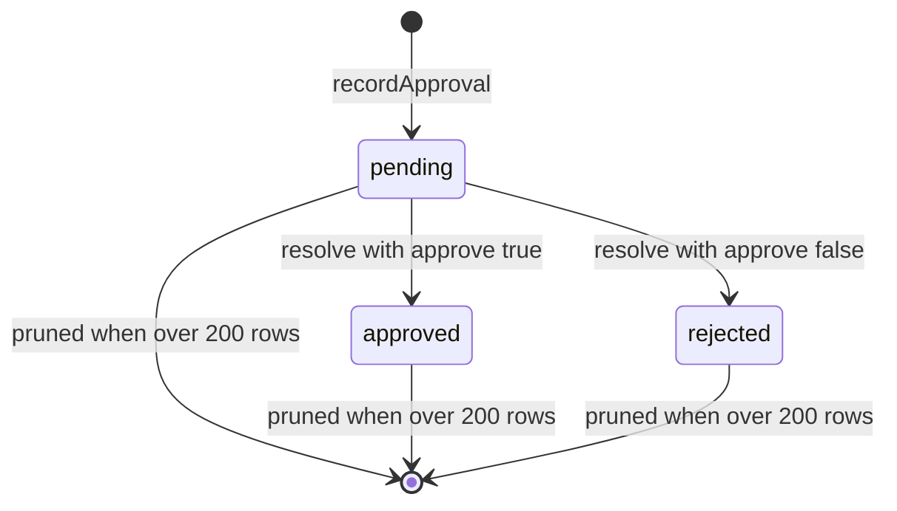

- Created as `pending` in [server/src/orchestrator/runner.ts:76-90](../server/src/orchestrator/runner.ts#L76-L90).
- The only transition out of `pending` is the conditional update in [server/src/approvals/approvalStore.ts:112-119](../server/src/approvals/approvalStore.ts#L112-L119). There is no way back to `pending`.
- Rows beyond the newest 200 are deleted on every insert, regardless of status ([server/src/approvals/approvalStore.ts:66-71](../server/src/approvals/approvalStore.ts#L66-L71), [server/src/approvals/approvalStore.ts:102](../server/src/approvals/approvalStore.ts#L102)). A pending approval can therefore vanish; see [09](09-ISSUES-AND-OPEN-QUESTIONS.md#risky-patterns).
- The status changes to `approved` or `rejected` **before** the resumed run starts, so the status records the human's decision, not whether the run succeeded.

### 5.2 Chat session (server)

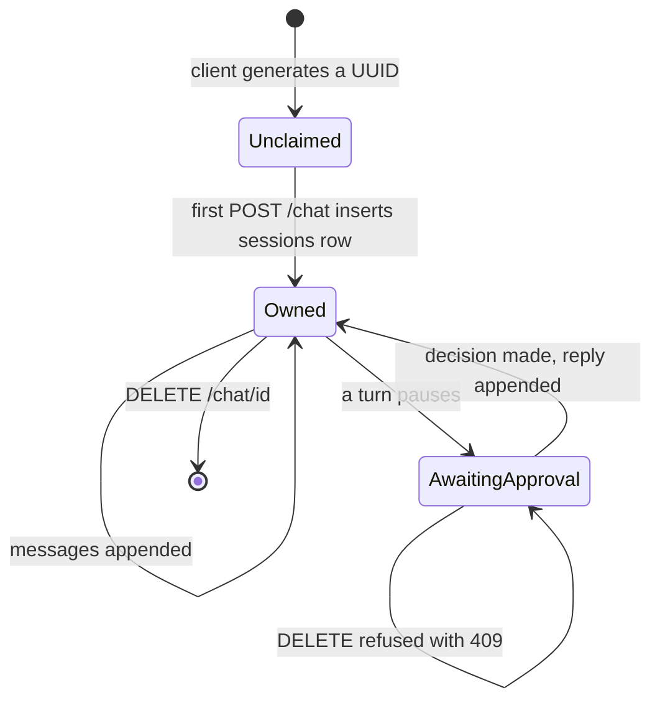

- A session id exists only in the browser until the first message is accepted ([client/src/hooks/use-chat.ts:43](../client/src/hooks/use-chat.ts#L43)).
- Ownership is set by `INSERT ... ON CONFLICT DO NOTHING`, so the first writer wins and later writers cannot change it ([server/src/conversation/session.store.ts:10-14](../server/src/conversation/session.store.ts#L10-L14)).
- "AwaitingApproval" is not a stored column. It is derived: the session has at least one pending row in `approvals` ([server/src/controllers/chat.controller.ts:311](../server/src/controllers/chat.controller.ts#L311)).
- Delete removes messages then the session row ([server/src/conversation/session.store.ts:130-133](../server/src/conversation/session.store.ts#L130-L133)). Traces and resolved approvals for that session are left behind.

### 5.3 Agent run outcome

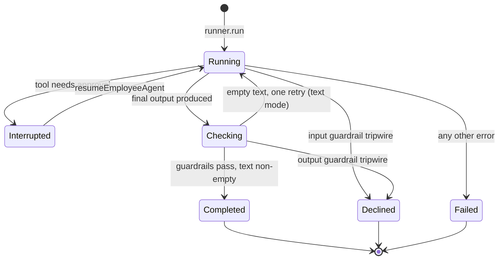

- `Completed` and `Interrupted` are the two values of `RunOutcome` ([server/src/orchestrator/runner.ts:48-58](../server/src/orchestrator/runner.ts#L48-L58)).
- `Declined` and `Failed` are not return values. They are exceptions that the controller sorts with `describeGuardrailFailure` ([server/src/controllers/chat.controller.ts:25-48](../server/src/controllers/chat.controller.ts#L25-L48)).
- The retry on empty output exists only in text mode ([server/src/orchestrator/runner.ts:113-127](../server/src/orchestrator/runner.ts#L113-L127)).

### 5.4 Assistant message bubble (client)

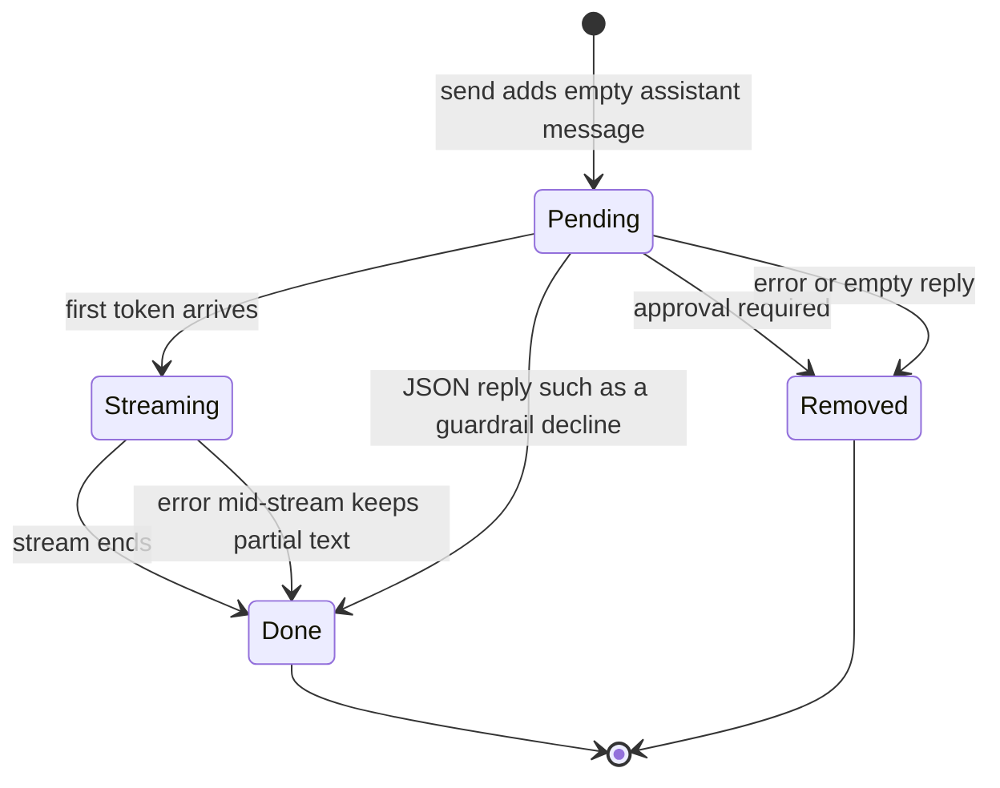

All transitions are in `send` in [client/src/hooks/use-chat.ts:139-216](../client/src/hooks/use-chat.ts#L139-L216). `ChatMessage.pending` is the only flag ([client/src/types/chat.ts:1-7](../client/src/types/chat.ts#L1-L7)).

---

## 6. Error and Edge-Case Flow

### 6.1 Server side of a chat turn

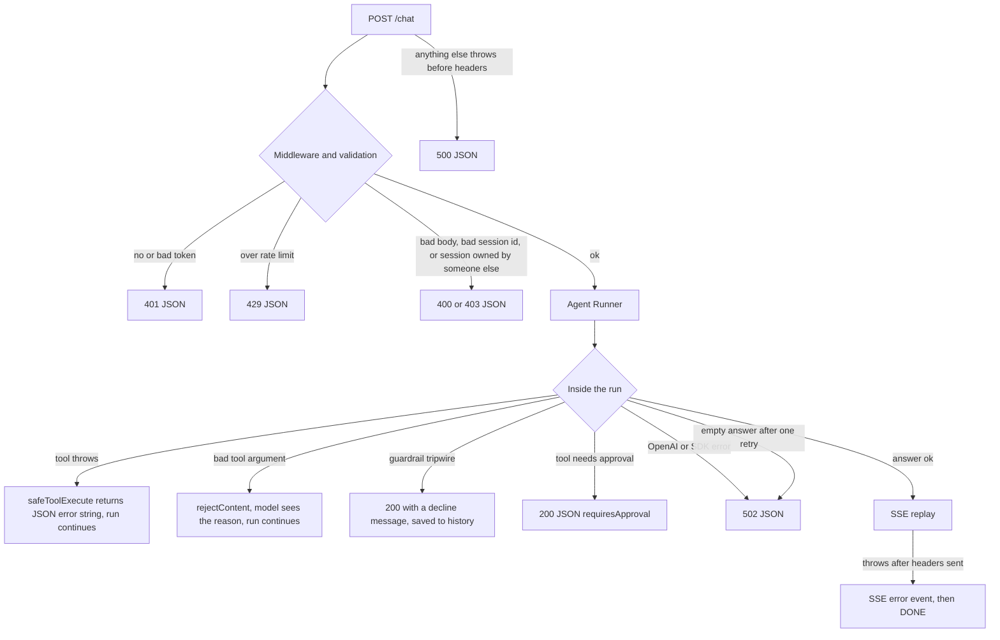

1. **Auth, rate limit, validation, ownership** all return `{ success: false, message }` with the matching status. Sources: [server/src/middleware/authenticate.ts:7-21](../server/src/middleware/authenticate.ts#L7-L21), [server/src/middleware/rateLimiters.ts:31-36](../server/src/middleware/rateLimiters.ts#L31-L36), [server/src/controllers/chat.controller.ts:89-120](../server/src/controllers/chat.controller.ts#L89-L120).
2. **Tool failures never end a run.** `safeToolExecute` logs with `console.error` and returns a generic JSON error for the model to relay ([server/src/utils/safeToolExecute.ts:13-18](../server/src/utils/safeToolExecute.ts#L13-L18)). Permission denials and "not found" are also returned as `{ "error": ... }` strings, not thrown. This includes every policy-search failure: a missing `DATABASE_URL`, an unreachable Postgres, a `knowledge.chunks` table that was never created, or a failed embeddings call all surface to the user as the assistant saying something went wrong, with the real cause only in the server console.
3. **Bad tool arguments** are rejected before execution and described to the model, which usually asks the user to correct the ID ([server/src/guardrails/toolMisuse.guardrail.ts:20-41](../server/src/guardrails/toolMisuse.guardrail.ts#L20-L41)).
4. **Guardrail tripwires are treated as a normal outcome, not an error.** The controller answers 200 with a fixed decline sentence and saves it as the assistant's message. Text mode returns it as JSON, not SSE ([server/src/controllers/chat.controller.ts:174-179](../server/src/controllers/chat.controller.ts#L174-L179)). JSON mode wraps it in the structured shape ([server/src/controllers/chat.controller.ts:154-159](../server/src/controllers/chat.controller.ts#L154-L159)). The specific reason is only logged with `console.warn`, never shown to the user ([server/src/controllers/chat.controller.ts:27-31](../server/src/controllers/chat.controller.ts#L27-L31)).
5. **Any other error from the run** is logged and returned as 502 ([server/src/controllers/chat.controller.ts:181-186](../server/src/controllers/chat.controller.ts#L181-L186)).
6. **Empty answers** are retried once inside the runner, then rejected with 502 by the controller. Nothing blank is saved ([server/src/orchestrator/runner.ts:120-126](../server/src/orchestrator/runner.ts#L120-L126), [server/src/controllers/chat.controller.ts:197-204](../server/src/controllers/chat.controller.ts#L197-L204)).
7. **The outer catch** covers everything else, such as a database error. Before headers are sent it returns 500. After, it can only write an SSE `error` event ([server/src/controllers/chat.controller.ts:225-239](../server/src/controllers/chat.controller.ts#L225-L239)).
8. In every failure after step 7 of flow 4.2, the **user's message has already been saved**. A 502 leaves a user message with no reply in the history.

### 6.2 Client side

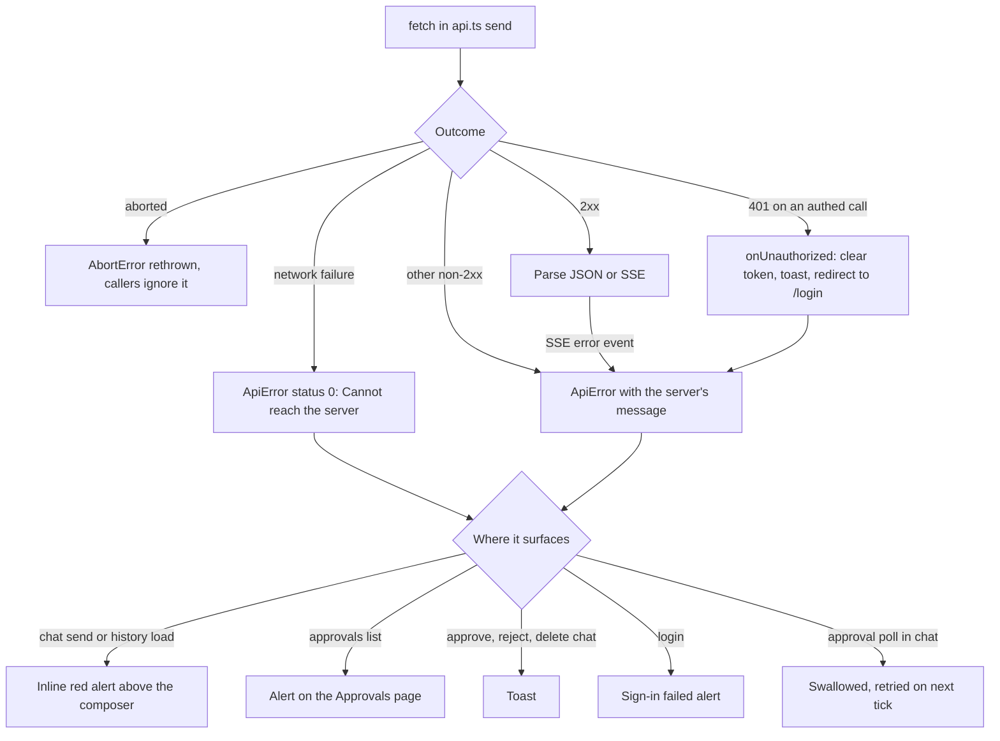

1. `send` converts a failed `fetch` into `ApiError(0, ...)` but lets `AbortError` through untouched ([client/src/lib/api.ts:59-64](../client/src/lib/api.ts#L59-L64)).
2. A 401 on any authenticated call fires the logout handler, then still throws ([client/src/lib/api.ts:66-69](../client/src/lib/api.ts#L66-L69)). Login passes `auth: false`, so a wrong password does not log anyone out.
3. The error message is the server's `message` field when present ([client/src/lib/api.ts:73-81](../client/src/lib/api.ts#L73-L81)).
4. An SSE `error` event is thrown as `ApiError(500, ...)` ([client/src/lib/api.ts:176-177](../client/src/lib/api.ts#L176-L177)).
5. Chat errors keep any partial text that already streamed and drop only an empty placeholder ([client/src/hooks/use-chat.ts:200-209](../client/src/hooks/use-chat.ts#L200-L209)).
6. A 404 while loading history shows "This conversation no longer exists." ([client/src/hooks/use-chat.ts:81-90](../client/src/hooks/use-chat.ts#L81-L90)).
7. A 404 or 409 when deciding an approval means someone else got there first; the list is refetched ([client/src/hooks/use-approvals.ts:68-76](../client/src/hooks/use-approvals.ts#L68-L76)).
8. Errors in the 4-second approval poll are ignored on purpose ([client/src/hooks/use-chat.ts:126-128](../client/src/hooks/use-chat.ts#L126-L128)).

### 6.3 Flows where errors are NOT handled

These are also listed in [09-ISSUES-AND-OPEN-QUESTIONS.md](09-ISSUES-AND-OPEN-QUESTIONS.md#missing-error-handling).

| Flow | What happens | Where |
| --- | --- | --- |
| Resuming an approved run throws (output guardrail trips, OpenAI error, corrupt state) | The approval is already marked `approved`. `decideApproval` has no try/catch, so Express's default handler returns a generic 500. No reply is written to the requester's session; their chat shows "approved" and nothing else. | [server/src/controllers/approvals.controller.ts:48](../server/src/controllers/approvals.controller.ts#L48), [server/src/orchestrator/runner.ts:181-188](../server/src/orchestrator/runner.ts#L181-L188) |
| `login` throws (for example `users.csv` missing) | No try/catch. Express 5 forwards the rejection to its default handler: 500 with an HTML body, which the client shows as "Request failed (500)". | [server/src/controllers/auth.controller.ts:13](../server/src/controllers/auth.controller.ts#L13) |
| A SQLite write fails in `httpLogger` | The `finish` callback throws outside the request chain. Nothing catches it. | [server/src/middleware/httpLogger.ts:17-31](../server/src/middleware/httpLogger.ts#L17-L31) |
| Unknown route | No 404 handler is registered. Unauthenticated requests get 401 from `authenticate`; authenticated ones get Express's default HTML 404. | [server/src/app.ts:50-62](../server/src/app.ts#L50-L62) |
| Process shutdown | No signal handling. | [server/src/server.ts](../server/src/server.ts) |

---

## 7. Deployment / Runtime View

Omitted. The repository contains no Dockerfile, docker-compose file, CI workflow, or cloud configuration at this commit. The only runtime description is the local two-terminal setup in [00-OVERVIEW.md](00-OVERVIEW.md#run): the API on port 3000 and the Vite dev server on port 5173.
