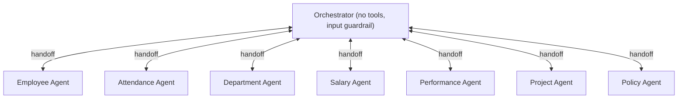

# Agents

## Purpose and responsibility

Define the LLM agents and how they connect. One **Orchestrator** routes; seven **domain agents** answer. Each agent is a name, a set of instructions (the system prompt), and a list of tools or handoffs. This module is almost entirely prompt text and wiring; the runtime behaviour comes from the SDK.

## Where it sits

Agents layer, driven by the [Agent Runner](agent-runner.md), using [Tools](tools.md) and [Guardrails](guardrails.md). See [Architecture 2.1](../03-ARCHITECTURE-AND-LIFECYCLE.md#21-server) and the walkthrough in [4.3](../03-ARCHITECTURE-AND-LIFECYCLE.md#43-inside-one-agent-run).

## The agent graph

Every arrow goes both ways: the Orchestrator can hand off to any specialist, and any specialist can hand back. Specialists cannot hand off to each other directly.

The whole graph exists **twice**: a plain-text copy and a "(Structured)" copy. The two copies never mix.

## Key files

| File | What it defines |
| --- | --- |
| [agents/orchestrator.agent.ts](../../server/src/agents/orchestrator.agent.ts) | `orchestratorAgent`, `orchestratorAgentStructured`, and the back-handoff wiring. |
| [agents/shared/createDomainAgent.ts](../../server/src/agents/shared/createDomainAgent.ts) | Factory returning `{ agent, structuredAgent }`. |
| [agents/shared/instructionFragments.ts](../../server/src/agents/shared/instructionFragments.ts) | Four reusable prompt blocks. |
| [agents/domains/*.agent.ts](../../server/src/agents/domains/) | One file per specialist. |
| [types/structuredResponse.ts](../../server/src/types/structuredResponse.ts) | The zod schema structured agents must fill. |

## The specialists

| Agent | Own tools | Borrowed tools | Knows who "me" is? | File |
| --- | --- | --- | --- | --- |
| Employee Agent | 4 employee tools | none | No | [employee.agent.ts:32-39](../../server/src/agents/domains/employee.agent.ts#L32-L39) |
| Attendance Agent | 3 attendance tools | `get_employee_by_id`, `get_employee_by_name` | Yes | [attendance.agent.ts:42-49](../../server/src/agents/domains/attendance.agent.ts#L42-L49) |
| Department Agent | 3 department tools | none | No | [department.agent.ts:25-32](../../server/src/agents/domains/department.agent.ts#L25-L32) |
| Salary Agent | 7 salary tools | the two employee lookups, `get_department_by_name` | Yes | [salary.agent.ts:52-62](../../server/src/agents/domains/salary.agent.ts#L52-L62) |
| Performance Agent | 3 performance tools | the two employee lookups | Yes | [performance.agent.ts:45-52](../../server/src/agents/domains/performance.agent.ts#L45-L52) |
| Project Agent | 2 project tools | the two employee lookups | No | [project.agent.ts:27-32](../../server/src/agents/domains/project.agent.ts#L27-L32) |
| Policy Agent | `search_hr_policies` | none | No, and it has no access to anyone's records | [policy.agent.ts:54-67](../../server/src/agents/domains/policy.agent.ts#L54-L67) |

"Borrowed tools" exist so a specialist can turn a name into an ID without a round trip through the Orchestrator. A user asks "what is Priya's salary?"; the Salary Agent calls `get_employee_by_name` itself, then `get_salary_by_employee`.

## Non-obvious logic, step by step

### The Orchestrator has no tools

[orchestrator.agent.ts:75-88](../../server/src/agents/orchestrator.agent.ts#L75-L88). It has `handoffs` and one input guardrail, nothing else. Its instructions ([orchestrator.agent.ts:30-73](../../server/src/agents/orchestrator.agent.ts#L30-L73)) tell it to:

- pick **one** specialist and hand off immediately;
- tell rules from records: what a policy says goes to the Policy Agent, what a person's data says goes to the matching data specialist, and a request needing both is handled one part at a time ([orchestrator.agent.ts:52-57](../../server/src/agents/orchestrator.agent.ts#L52-L57));
- default to the Employee Agent when a request spans several domains;
- ask a clarifying question itself, without handing off, when it cannot tell;
- treat a request handed back to it as a fresh routing decision.

`promptWithHandoffInstructions` ([orchestrator.agent.ts:30](../../server/src/agents/orchestrator.agent.ts#L30)) is an SDK helper that prepends standard text explaining to the model what handoffs are and that they should be done without commentary.

### How a handoff works

The SDK presents each agent in `handoffs` to the model as a function named like `transfer_to_salary_agent`. When the model calls it, the SDK switches the "current agent" inside the same run. The next model call uses the new agent's instructions and tools, with the same conversation. Nothing returns to the app in between.

### Two-way wiring without a circular import

A specialist needs the Orchestrator in its `handoffs`, and the Orchestrator needs the specialists in its own. If each file imported the other, module loading would cycle. The fix is at the bottom of the Orchestrator file: after all agents exist, push the Orchestrator into each specialist's array ([orchestrator.agent.ts:116-140](../../server/src/agents/orchestrator.agent.ts#L116-L140)). No domain file imports the Orchestrator.

A consequence: a specialist imported on its own, without `orchestrator.agent.ts` ever being loaded, would have no way back. In practice the runner always imports the Orchestrator first.

### The factory and the two variants

`createDomainAgent` ([createDomainAgent.ts:41-61](../../server/src/agents/shared/createDomainAgent.ts#L41-L61)) builds:

- `agent`: plain. Final output is free text.
- `structuredAgent`: named `"<name> (Structured)"`, same tools, instructions plus `structuredOutputInstructions`, and `outputType: StructuredResponseSchema`. With an `outputType`, the SDK asks the model for JSON matching the schema and parses it.

Why two full graphs instead of one agent with a switch? An agent's `outputType` is fixed when it is constructed. And a handoff keeps the run inside one graph, so the plain Orchestrator must only reach plain specialists, and the structured one only structured specialists ([orchestrator.agent.ts:79-87](../../server/src/agents/orchestrator.agent.ts#L79-L87), [orchestrator.agent.ts:101-109](../../server/src/agents/orchestrator.agent.ts#L101-L109)).

`withSuffix` ([createDomainAgent.ts:28-39](../../server/src/agents/shared/createDomainAgent.ts#L28-L39)) appends the structured suffix whether the base instructions are a string or a function. For a function it returns a new async function that awaits the base and concatenates.

The factory also accepts an optional `modelSettings` and applies it to both variants ([createDomainAgent.ts:21-22](../../server/src/agents/shared/createDomainAgent.ts#L21-L22), [createDomainAgent.ts:47-58](../../server/src/agents/shared/createDomainAgent.ts#L47-L58)). It is spread in through an `extra` object so that an unset value is omitted, not passed as `undefined`, which `exactOptionalPropertyTypes` would reject. Only the Policy Agent uses it.

### Dynamic instructions: telling the model who "me" is

The run `context` (the authenticated user) is visible to tool code but is never sent to the model. So when a user says "my salary", the model has no idea which employee that is.

Three agents solve this with a function for `instructions`. `buildInstructions` receives the `RunContext`, and appends a sentence with the user's employee ID and role, plus an order to use that ID for "my / me / I" ([salary.agent.ts:42-50](../../server/src/agents/domains/salary.agent.ts#L42-L50), [attendance.agent.ts:32-40](../../server/src/agents/domains/attendance.agent.ts#L32-L40), [performance.agent.ts:35-43](../../server/src/agents/domains/performance.agent.ts#L35-L43)). The three functions are near-identical copies.

The Employee, Department, Project, and Policy agents use static strings, so "what projects am I on?" will make the Project Agent ask for an ID or name.

This note is a convenience, not a security control. Even if the model ignores it and asks for someone else's ID, the tool's role check refuses ([tools.md](tools.md#role-rules)).

### The Policy Agent and forced tool choice

[policy.agent.ts](../../server/src/agents/domains/policy.agent.ts). The other six specialists look up records. This one explains rules, and its only source is whatever `search_hr_policies` returns. How the search works is in [policy-knowledge.md](policy-knowledge.md).

Its instructions ([policy.agent.ts:5-52](../../server/src/agents/domains/policy.agent.ts#L5-L52)) are stricter than the others' because retrieved text is easy to over-read:

- **Search first, always**, with a short self-contained query. One search per topic when a question covers several. One reworded retry before giving up.
- **Answer only from the passages**, with their exact figures, and name the policy and section.
- **Do not assume the user's category.** Many rules differ by employment type, designation, location, or probation status. If the user has not said which applies, give the answer for each.
- **Separate what the policy says from what follows from it.** For a specific case the text does not spell out, state the rule, say that the case is not addressed, then explain how the rule would apply.
- **Admit gaps.** Search always returns the nearest passages, even for a topic the documents do not cover. If they do not answer the question, say so and point to the HR contact.
- **Never mention tools or searching.** This also keeps answers clear of the sensitive-info guardrail's tool-name scan.
- In structured mode, put the whole answer in `summary` and leave `employees` and `metrics` empty.

The agent is created with `modelSettings: { toolChoice: searchHrPoliciesTool.name }` ([policy.agent.ts:61-66](../../server/src/agents/domains/policy.agent.ts#L61-L66)). **Tool choice** tells the model API which tool it must call on a turn. The comment explains why an instruction was not enough: the default model skipped the search on roughly 60% of follow-up questions, either refusing or returning empty text. Forcing applies to the first model turn only. After a tool runs, the SDK resets tool choice to automatic (`resetToolChoice` defaults to true), so the agent can then write its answer, search again, or hand back.

A side effect: the Policy Agent cannot hand back or ask a clarifying question until it has searched once, even when a request was routed to it by mistake.

### Shared prompt fragments

[instructionFragments.ts](../../server/src/agents/shared/instructionFragments.ts):

| Fragment | Lines | Rule it teaches |
| --- | --- | --- |
| `nameResolutionInstructions` | 1-8 | Resolve a name to an ID first. If more than one match, list them and ask. |
| `departmentResolutionInstructions` | 10-16 | Same for department names. |
| `structuredOutputInstructions` | 18-29 | Fill the schema. Use `null` for anything not looked up; never default to 0, because 0 is a real value. |
| `outOfScopeHandoffInstructions` | 31-41 | Answer only your own domain. Hand anything else back to the Orchestrator. |

The seed data makes the "more than one match" rule matter: `employees.csv` has several people sharing first or last names (for example Aditi Shah and Priya Shah on the first two rows).

### The structured schema

[structuredResponse.ts:3-30](../../server/src/types/structuredResponse.ts#L3-L30): `summary` (string), `employees` (array or null), `metrics` (array or null). Inside an employee, most fields are `.nullable()` rather than optional. OpenAI's structured output mode requires every property to be present, so "unknown" is expressed as `null`.

## Inputs, outputs, side effects, dependencies

- **Inputs:** conversation items and the run context, supplied by the runner.
- **Outputs:** a final text or structured object; or a handoff; or a tool call.
- **Side effects:** none of their own. Module import constructs the agents and mutates `handoffs` arrays.
- **Depends on:** [Tools](tools.md), [Guardrails](guardrails.md) (input guardrail), `StructuredResponseSchema`.

## Why it is built this way, and trade-offs

- **Router plus specialists** keeps each prompt short and each tool list small, which helps the model choose the right tool. The cost is extra model calls: every question pays for an Orchestrator turn before any work happens.
- **Hub and spoke only.** Cross-domain questions ("Priya's department and salary") bounce specialist → Orchestrator → specialist. Predictable, but slow for multi-part questions.
- **No explicit model.** No agent sets `model`, so all use the SDK default (`gpt-5.4-mini` in the installed SDK version unless `OPENAI_DEFAULT_MODEL` is set).
- **Behaviour lives in prose.** Routing and scope rules are instructions, which the model can ignore. Anything that must hold (roles, ID formats, approvals) is enforced in code elsewhere.
- **Duplicated graphs** double the number of agent objects and require care to keep the two handoff lists in step.

## Source files covered

- `server/src/agents/orchestrator.agent.ts`
- `server/src/agents/shared/createDomainAgent.ts`
- `server/src/agents/shared/instructionFragments.ts`
- `server/src/agents/domains/attendance.agent.ts`
- `server/src/agents/domains/department.agent.ts`
- `server/src/agents/domains/employee.agent.ts`
- `server/src/agents/domains/performance.agent.ts`
- `server/src/agents/domains/policy.agent.ts`
- `server/src/agents/domains/project.agent.ts`
- `server/src/agents/domains/salary.agent.ts`
- `server/src/types/structuredResponse.ts`
