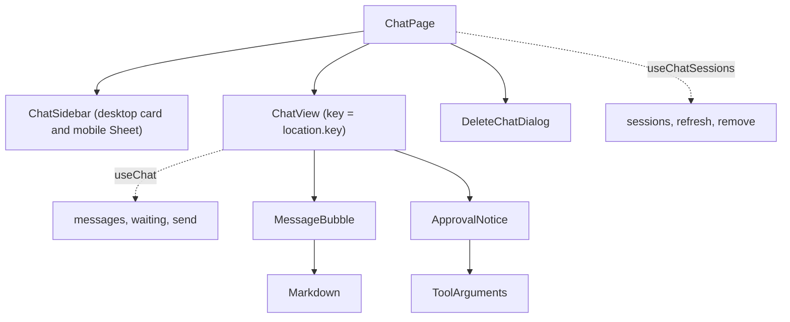

# Client Chat

## Purpose and responsibility

The chat screen: a history sidebar, the message list, the composer, and the "waiting for approval" state. It owns the hardest client-side logic in the project: optimistic messages, streamed text, the transition from a new chat to a saved one, and polling for an approver's decision.

## Where it sits

A feature module rendered inside `AppLayout`. See [Architecture 2.2](../03-ARCHITECTURE-AND-LIFECYCLE.md#22-client), flows [4.2](../03-ARCHITECTURE-AND-LIFECYCLE.md#42-user-sends-a-chat-message) and [4.4](../03-ARCHITECTURE-AND-LIFECYCLE.md#44-sensitive-tool-call-pause-approve-resume), and [state diagram 5.4](../03-ARCHITECTURE-AND-LIFECYCLE.md#54-assistant-message-bubble-client).

## Key files

| File | Role |
| --- | --- |
| [pages/chat-page.tsx](../../client/src/pages/chat-page.tsx) | `ChatPage` (sidebar, dialogs, routing) and `ChatView` (one conversation). |
| [hooks/use-chat.ts](../../client/src/hooks/use-chat.ts) | All state and effects for one conversation. |
| [hooks/use-chat-sessions.ts](../../client/src/hooks/use-chat-sessions.ts) | The session list and delete. |
| [components/chat/chat-sidebar.tsx](../../client/src/components/chat/chat-sidebar.tsx) | Grouped history with a per-row menu. |
| [components/chat/message-bubble.tsx](../../client/src/components/chat/message-bubble.tsx) | One message or the typing skeleton. |
| [components/chat/markdown.tsx](../../client/src/components/chat/markdown.tsx) | Markdown rendering for assistant text. |
| [components/chat/approval-notice.tsx](../../client/src/components/chat/approval-notice.tsx) | The "Waiting for approval" card. |
| [components/chat/delete-chat-dialog.tsx](../../client/src/components/chat/delete-chat-dialog.tsx) | Delete confirmation. |
| [components/tool-arguments.tsx](../../client/src/components/tool-arguments.tsx) | Shows a tool call's arguments. Shared with Client Approvals. |
| [lib/format.ts](../../client/src/lib/format.ts) | `groupSessionsByDate`, `humanizeToolName`, `parseToolArguments`, `formatDateTime`. |
| [types/chat.ts](../../client/src/types/chat.ts) | `ChatMessage`, `WaitingApproval`, `SessionSeed`. |

## Component structure

`ChatPage` owns things that outlive a single conversation (the session list, the drawer, the delete dialog). `ChatView` owns one conversation and is thrown away on navigation.

## Non-obvious logic, step by step

### The URL is the current conversation

There is no "selected session" state. `/chat` means a new conversation; `/chat/<id>` means that saved one. `ChatPage` reads `sessionId` with `useParams` and passes it down ([chat-page.tsx:28](../../client/src/pages/chat-page.tsx#L28)). Selecting a chat is `navigate("/chat/" + id)` ([chat-page.tsx:37-40](../../client/src/pages/chat-page.tsx#L37-L40)). Refresh and bookmarks work for free.

### `key={location.key}`: reset by remounting

[chat-page.tsx:88-94](../../client/src/pages/chat-page.tsx#L88-L94). React Router gives each navigation a unique `location.key`. Using it as the React `key` means every navigation destroys the old `ChatView` and builds a new one. So:

- `useChat` never needs "reset when the session changes" logic. Initial state *is* the reset.
- Unmounting aborts any request the old conversation had in flight ([use-chat.ts:137](../../client/src/hooks/use-chat.ts#L137)).
- Clicking "New chat" while already on `/chat` still produces a fresh, empty view, because the key changes even though the path does not.

### A new chat gets its id before it exists

`useState(() => crypto.randomUUID())` creates `draftId` once per mount ([use-chat.ts:43](../../client/src/hooks/use-chat.ts#L43)). `activeId = sessionId ?? draftId` ([use-chat.ts:44](../../client/src/hooks/use-chat.ts#L44)). The very first `POST /chat` therefore already carries a valid UUID, and the server creates the session when it stores that message.

### From `/chat` to `/chat/<id>` without a blank screen

After the first send succeeds, the conversation should have its own URL. But navigating changes `location.key`, which remounts `ChatView`, which would start empty and refetch.

The solution is a **seed** ([chat-page.tsx:125-136](../../client/src/pages/chat-page.tsx#L125-L136)):

1. `send` sets `started` once the server has responded ([use-chat.ts:172](../../client/src/hooks/use-chat.ts#L172)).
2. An effect waits for `sessionId === undefined && started && !sending`.
3. It navigates with `replace: true` and puts the current `messages` and `waiting` into router `state` as `seed`.
4. The new `ChatView` reads `location.state.seed` ([chat-page.tsx:115](../../client/src/pages/chat-page.tsx#L115)) and `useChat` uses it for initial state ([use-chat.ts:46-50](../../client/src/hooks/use-chat.ts#L46-L50)). With a seed, `loadingHistory` starts `false`, so no skeleton flashes.
5. The load effect still runs and replaces the seed with the server's copy.

`replace: true` keeps the back button from returning to an empty `/chat`. The `satisfies SessionSeed` on [line 133](../../client/src/pages/chat-page.tsx#L133) type-checks the object literal without widening it.

Waiting for `!sending` matters: navigating mid-stream would unmount the view and abort the request.

`started` is set after the response arrives but is **not** set when `send` throws. A new chat whose first message fails with 502 stays on `/chat`, even though the server did save the user's message under the draft id. It appears in the sidebar after the refresh in `finally`.

### `send`

[use-chat.ts:139-216](../../client/src/hooks/use-chat.ts#L139-L216):

1. Append the user message and an empty assistant message with `pending: true`. Both get client-generated ids. This is the optimistic update.
2. Define `patchAssistant(fn)` and `dropAssistant()`, which find the placeholder by its id. All updates use the functional `setMessages(prev => ...)` form, because many token callbacks fire between renders and each must build on the latest state.
3. Create an `AbortController`, store it in a ref for unmount cleanup.
4. Call `api.chat.send`. The `onToken` callback appends text and clears `pending`.
5. Handle the result:

| Result | Action |
| --- | --- |
| `approval` | Remove the placeholder. Add a `WaitingApproval`. |
| `reply` with blank text | Remove the placeholder. Show the empty-reply error. |
| `reply` | Put the text in the placeholder. |
| `streamed` but no token ever arrived | Remove the placeholder. Show the empty-reply error. |
| `streamed` | Clear `pending` (already false after the first token). |

6. On error: ignore `AbortError`; otherwise remove the placeholder only if it is still empty, keeping any partial text, and show the message.
7. `finally`: clear `sending`, call `onActivity` so the sidebar refetches.

`receivedText` is a plain local variable, not state, because it is only read inside the same async call.

### Loading a saved conversation

[use-chat.ts:68-96](../../client/src/hooks/use-chat.ts#L68-L96). Runs only when the URL has a `sessionId`. It fetches the transcript and the session's approvals in parallel with `Promise.all`, keeps only pending approvals, and maps a 404 to "This conversation no longer exists."

`toChatMessages` gives server messages ids of the form `server-<index>` and drops blank ones ([use-chat.ts:11-15](../../client/src/hooks/use-chat.ts#L11-L15)). The index is taken before filtering, so ids stay stable.

### The approval poll

[use-chat.ts:102-135](../../client/src/hooks/use-chat.ts#L102-L135). Active only while `waiting` is non-empty. Every 4 seconds:

1. Fetch this session's approvals.
2. Compute which entries of `waiting` are no longer pending.
3. If none, do nothing.
4. For each resolved one, toast "approved" or "rejected".
5. Reload the transcript. The answer the resumed run produced was saved on the server and was never sent to this browser.
6. Tell the sidebar to refresh.
7. Replace `waiting` with whatever is still pending. This also picks up a *new* approval raised by the resumed run.

`waiting` is in the dependency array, so the effect and its interval are recreated whenever the list changes. This avoids the classic stale-closure bug where an interval callback keeps comparing against the list from when it was created. When the list becomes empty the effect returns early and polling stops.

Errors are swallowed; the next tick tries again.

### The session list

`useChatSessions` ([use-chat-sessions.ts:6-39](../../client/src/hooks/use-chat-sessions.ts#L6-L39)) uses the **reload key** pattern: `refresh()` increments a counter that is the fetch effect's only dependency, so the fetch reruns. `useApprovals` uses the same pattern.

`remove` calls the API first and only then filters the row out locally. If the server says 409 (an approval is pending), it throws, the list is untouched, and `ChatPage` shows the server's message as a toast ([chat-page.tsx:46-56](../../client/src/pages/chat-page.tsx#L46-L56)). Deleting the open conversation also navigates to `/chat`.

### Sidebar grouping

`groupSessionsByDate` buckets by `updatedAt` into Today, Yesterday, Previous 7 days, and Older, using local midnight as the reference, and drops empty buckets ([format.ts:40-60](../../client/src/lib/format.ts#L40-L60)). Input is already newest-first, so buckets stay ordered. `now` is a parameter with a default, which makes the function testable.

The same `sidebar` element is rendered twice: in a fixed card on desktop and inside a slide-out `Sheet` on mobile ([chat-page.tsx:72-84](../../client/src/pages/chat-page.tsx#L72-L84)).

### Rendering messages

[message-bubble.tsx:27-39](../../client/src/components/chat/message-bubble.tsx#L27-L39):

- `pending` → a two-line skeleton. The comment explains the long wait: the server finishes the whole agent run before the first token.
- User text → a plain `
` with `whitespace-pre-wrap`. It is not parsed as markdown, so what you typed is what you see.
- Assistant text → `<Markdown>`.

`react-markdown` builds React elements and does not render raw HTML, so neither model output nor user input can inject markup ([markdown.tsx:13-14](../../client/src/components/chat/markdown.tsx#L13-L14)). `remark-gfm` adds tables, which are mapped onto the UI kit's table components. Links open in a new tab with `rel="noreferrer noopener"`.

During streaming, markdown is re-parsed on every token, so a half-arrived table briefly renders as plain text.

### `ApprovalNotice` is not a message

It renders from the `waiting` array, after the messages, and never enters `messages` ([chat-page.tsx:202-204](../../client/src/pages/chat-page.tsx#L202-L204)). After a refresh it is rebuilt from the server's pending approvals.

`ToolArguments` shows the arguments as key/value pairs when they parse as a JSON object, and as raw text otherwise, so nothing is hidden from a reviewer ([tool-arguments.tsx:6-31](../../client/src/components/tool-arguments.tsx#L6-L31)).

### Composer details

- Enter sends; Shift+Enter makes a newline; Enter during IME composition is ignored so choosing a candidate does not send ([chat-page.tsx:147-154](../../client/src/pages/chat-page.tsx#L147-L154)).
- The draft is cleared *before* sending. If the send fails, the typed text is gone, though the user bubble remains in the list.
- Auto-scroll: an effect scrolls a sentinel `
` into view whenever `messages` or `waiting` change, which includes every token ([chat-page.tsx:120-123](../../client/src/pages/chat-page.tsx#L120-L123)).

### `DeleteChatDialog` and derived state

The parent sets `session` to `null` to close the dialog, but the close animation still renders for a moment. To stop the title flashing empty, the dialog remembers the last non-null session in `shown`, updating it during render with `if (session && session !== shown) setShown(session)` ([delete-chat-dialog.tsx:30-31](../../client/src/components/chat/delete-chat-dialog.tsx#L30-L31)). Setting state during render like this is React's sanctioned pattern for deriving state from props.

## Inputs, outputs, side effects, dependencies

- **Inputs:** URL parameter, router state seed, user typing.
- **Outputs:** rendered conversation; navigation.
- **Side effects:** API calls, a 4-second interval while waiting, toasts.
- **Depends on:** [Client API Layer](client-api.md), [Client UI Kit](client-ui-kit.md).

## Why it is built this way, and trade-offs

- **Remount instead of reset** trades a little re-rendering for the removal of an entire category of "state from the previous chat leaked" bugs.
- **Polling for approvals** needs no server push infrastructure. It costs a request every 4 seconds per waiting chat and up to 4 seconds of delay.
- **Client-side message ids differ from server ids.** After any reload from the server, every bubble gets a new key and re-mounts. Harmless here.
- **No stop button.** A send can only be cancelled by navigating away.

## Source files covered

- `client/src/pages/chat-page.tsx`
- `client/src/hooks/use-chat.ts`
- `client/src/hooks/use-chat-sessions.ts`
- `client/src/components/chat/approval-notice.tsx`
- `client/src/components/chat/chat-sidebar.tsx`
- `client/src/components/chat/delete-chat-dialog.tsx`
- `client/src/components/chat/markdown.tsx`
- `client/src/components/chat/message-bubble.tsx`
- `client/src/components/tool-arguments.tsx`
- `client/src/lib/format.ts`
- `client/src/types/chat.ts`
