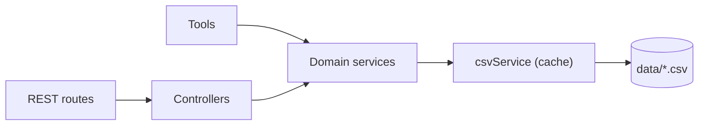

# Domain Data

## Purpose and responsibility

Read the company's HR data from CSV files and expose it two ways: as service functions (used by agent [Tools](tools.md)) and as plain REST endpoints (usable without any model call). This module is conventional CRUD-style code with only the R.

## Where it sits

It appears twice in [Architecture 2.1](../03-ARCHITECTURE-AND-LIFECYCLE.md#21-server): "Domain Data (REST routes)" in the API layer and "Domain Data (services)" in the data layer. Both end in the same service singletons.

## Layers

## Key files

### CSV reader

[services/csv.service.ts](../../server/src/services/csv.service.ts): `readCsv<TRow, TResult>(fileName, mapper)` streams a file through `csv-parser`, maps each row, caches the array by file name, and resolves ([csv.service.ts:13-36](../../server/src/services/csv.service.ts#L13-L36)). `clearCache` exists but nothing calls it.

### Domain services

Each file exports a class and a singleton instance.

| Service | File | Functions |
| --- | --- | --- |
| `employeeService` | [employee.service.ts](../../server/src/services/employee.service.ts) | `getAllEmployees`, `getEmployeeById`, `getEmployeeByName`, `getEmployeesByDepartment` |
| `departmentService` | [department.service.ts](../../server/src/services/department.service.ts) | `getDepartment` (returns all), `getDepartmentById`, `getDepartmentByName` |
| `attendanceService` | [attendance.service.ts](../../server/src/services/attendance.service.ts) | `getAttendance`, `getAttendanceByEmployee`, `getAttendancePercentage` |
| `salaryServices` | [salary.service.ts](../../server/src/services/salary.service.ts) | `getSalaries`, `getSalaryByEmployee`, `getHighestSalary`, `getAverageSalary`, `getEmployeesBySalaryRange`, `getHighestSalaryInDepartment`, `generateSalaryReport` |
| `performanceService` | [performance.service.ts](../../server/src/services/performance.service.ts) | `getPerformance`, `getPerformanceByEmployee`, `getTopPerformers` |
| `projectServices` | [project.service.ts](../../server/src/services/project.service.ts) | `getProjects`, `getProjectsByEmployee` |

Naming is inconsistent: `salaryServices` and `projectServices` are plural; the rest are singular.

### Types

Each file in [types/](../../server/src/types/) declares two interfaces: the domain model in camelCase (`Salary`) and the raw CSV row in the file's PascalCase headers (`SalaryCsvRow`). The mapper in each service converts one to the other.

### REST endpoints

| Endpoint | Access | Route line |
| --- | --- | --- |
| `GET /employees` | Any user | [employee.routes.ts:32](../../server/src/routes/employee.routes.ts#L32) |
| `GET /employees/search?name=` | Any user | [employee.routes.ts:60](../../server/src/routes/employee.routes.ts#L60) |
| `GET /employees/department/:departmentId` | Any user | [employee.routes.ts:90](../../server/src/routes/employee.routes.ts#L90) |
| `GET /employees/:id` | Any user | [employee.routes.ts:120](../../server/src/routes/employee.routes.ts#L120) |
| `GET /departments` | Any user | [departments.route.ts:27](../../server/src/routes/departments.route.ts#L27) |
| `GET /projects` | Any user | [projects.routes.ts:30](../../server/src/routes/projects.routes.ts#L30) |
| `GET /projects/employee/:employeeId` | Any user | [projects.routes.ts:60](../../server/src/routes/projects.routes.ts#L60) |
| `GET /attendance` | manager, admin | [attendance.routes.ts:35](../../server/src/routes/attendance.routes.ts#L35) |
| `GET /attendance/percentage/:employeeId` | Own or elevated | [attendance.routes.ts:67](../../server/src/routes/attendance.routes.ts#L67) |
| `GET /attendance/employee/:employeeId` | Own or elevated | [attendance.routes.ts:101](../../server/src/routes/attendance.routes.ts#L101) |
| `GET /salaries` | manager, admin | [salaries.routes.ts:43](../../server/src/routes/salaries.routes.ts#L43) |
| `GET /salaries/highest` | manager, admin | [salaries.routes.ts:72](../../server/src/routes/salaries.routes.ts#L72) |
| `GET /salaries/average` | manager, admin | [salaries.routes.ts:102](../../server/src/routes/salaries.routes.ts#L102) |
| `GET /salaries/range?min=&max=` | manager, admin | [salaries.routes.ts:142](../../server/src/routes/salaries.routes.ts#L142) |
| `GET /salaries/:employeeId` | Own or elevated | [salaries.routes.ts:185](../../server/src/routes/salaries.routes.ts#L185) |
| `GET /performance` | manager, admin | [performance.routes.ts:41](../../server/src/routes/performance.routes.ts#L41) |
| `GET /performance/top?rating=` | manager, admin | [performance.routes.ts:77](../../server/src/routes/performance.routes.ts#L77) |
| `GET /performance/employee/:employeeId` | Own or elevated | [performance.routes.ts:118](../../server/src/routes/performance.routes.ts#L118) |

In `salaries.routes.ts`, the fixed paths `/highest`, `/average`, and `/range` are registered before `/:employeeId` for the same reason as in the employee routes (see below).

All respond `{ success: true, data }` or `{ success: false, message }`.

## Non-obvious logic, step by step

### The cache

`CsvService` keeps `Map<fileName, rows>` ([csv.service.ts:11](../../server/src/services/csv.service.ts#L11)). The first call for a file parses it; every later call returns the same array ([csv.service.ts:17-19](../../server/src/services/csv.service.ts#L17-L19)). Effects:

- Edits to any CSV, including `users.csv`, are invisible until the server restarts.
- Callers share one array. Services only `filter`, `find`, and `reduce`, which do not mutate it. `getTopPerformers` sorts, but on the new array `filter` returns ([performance.service.ts:25-27](../../server/src/services/performance.service.ts#L25-L27)).
- If two requests ask for an uncached file at the same moment, both parse it; the second simply overwrites the first's cache entry.

### Locating `data/`

`repoRoot` is computed from the module's own location with `import.meta.url`, three levels up from `server/src/services/` ([csv.service.ts:6-8](../../server/src/services/csv.service.ts#L6-L8)). The path is therefore independent of the directory the server is started from. `database.ts` uses the same approach.

### CSV values are strings

`csv-parser` yields every field as a string. The row interfaces declare some as `number` (for example `SalaryCsvRow.CTC`), which is not true at runtime; the mappers convert explicitly with `Number(...)` ([salary.service.ts:8-10](../../server/src/services/salary.service.ts#L8-L10)). Treat the `*CsvRow` types as documentation of column names rather than of types.

### Attendance percentage

[attendance.service.ts:24-42](../../server/src/services/attendance.service.ts#L24-L42):

1. Take the employee's records.
2. Drop `Holiday` and `Leave` days. They are not working days.
3. If nothing is left, return `null` (not 0).
4. Count `Present` and `WFH` as 1, `Half-Day` as 0.5, anything else (such as `Absent`) as 0.
5. Divide by the number of working days, times 100, rounded to two decimals.

With roughly one attendance row per employee in the seed data, most results are 0, 50, 100, or `null`.

### Name search

`getEmployeeByName` lowercases and matches the query as a substring of the full name, first name, or last name ([employee.service.ts:29-38](../../server/src/services/employee.service.ts#L29-L38)). The second and third conditions are redundant given the first. Searching "Shah" returns every Shah, which is why agents are told to ask when there are several matches.

### "Salary" means CTC

Highest, average, and range all compare `ctc` (cost to company: base plus bonus), not `baseSalary` ([salary.service.ts:21-39](../../server/src/services/salary.service.ts#L21-L39)).

### Route order in `employee.routes.ts`

`/search` and `/department/:departmentId` are registered before `/:id` ([employee.routes.ts:60-120](../../server/src/routes/employee.routes.ts#L60-L120)). Express matches in registration order, so if `/:id` came first, `/employees/search` would be handled as an employee whose id is "search". The inline comment says "keep this LAST".

### Controllers

Each handler is a try/catch around one service call. Any exception becomes `500 "Unable to read CSV"`, whatever actually failed. Parameter guards vary in style from file to file (`typeof x !== "string"`, `Array.isArray(x)`, `!x`) but do the same job.

`getAttendancePercentage` returns `attendancePercentage: null` with status 200 for an unknown employee ([attendance.controller.ts:34-41](../../server/src/controllers/attendance.controller.ts#L34-L41)), whereas the equivalent tool returns an error.

## Inputs, outputs, side effects, dependencies

- **Inputs:** IDs, names, numeric ranges.
- **Outputs:** typed arrays and objects.
- **Side effects:** file reads on first use; the in-memory cache. Nothing is ever written.
- **Depends on:** `csv-parser`, Node `fs` and `path`. REST routes depend on [Auth and Access Control](auth-and-access-control.md).

## Why it is built this way, and trade-offs

- **CSV as the database** makes the project runnable with no setup and the data easy to inspect. There are no indexes; every lookup is a linear scan over at most 100 rows.
- **REST and tools share services**, so there is one implementation of each query. The REST API also allows the role rules to be tested with curl and no model spend.
- **Singleton instances of classes** behave like modules of functions. Nothing uses the classes for inheritance or injection.
- **No foreign-key checks.** `departments.DepartmentHeadID` and `employees.ManagerID` are just strings.

## Source files covered

- `server/src/services/csv.service.ts`
- `server/src/services/attendance.service.ts`
- `server/src/services/department.service.ts`
- `server/src/services/employee.service.ts`
- `server/src/services/performance.service.ts`
- `server/src/services/project.service.ts`
- `server/src/services/salary.service.ts`
- `server/src/controllers/attendance.controller.ts`
- `server/src/controllers/departments.controller.ts`
- `server/src/controllers/employee.controller.ts`
- `server/src/controllers/performance.controller.ts`
- `server/src/controllers/projects.controller.ts`
- `server/src/controllers/salaries.controller.ts`
- `server/src/routes/attendance.routes.ts`
- `server/src/routes/departments.route.ts`
- `server/src/routes/employee.routes.ts`
- `server/src/routes/performance.routes.ts`
- `server/src/routes/projects.routes.ts`
- `server/src/routes/salaries.routes.ts`
- `server/src/types/attendance.ts`
- `server/src/types/department.ts`
- `server/src/types/employee.ts`
- `server/src/types/performance.ts`
- `server/src/types/project.ts`
- `server/src/types/salary.ts`
- `data/attendance.csv`
- `data/departments.csv`
- `data/employees.csv`
- `data/performance.csv`
- `data/projects.csv`
- `data/salaries.csv`
