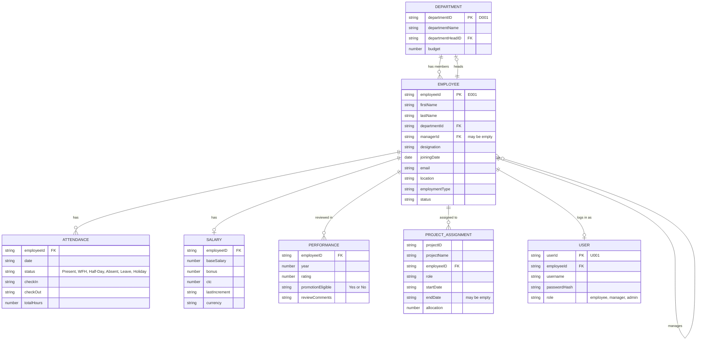
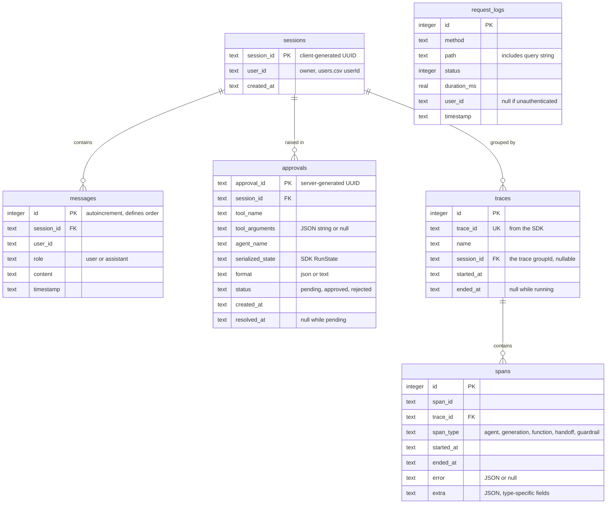
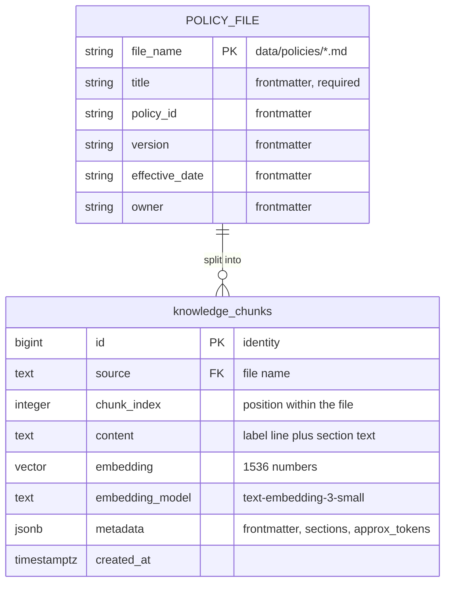

# Data and State

Where every piece of data lives, what shape it has, how it changes, and whether it survives a restart.

## The five places state lives

| Place | Holds | Survives server restart? | Survives browser refresh? |
| --- | --- | --- | --- |
| CSV files in `data/` | HR seed data and user accounts | Yes (read-only) | n/a |
| SQLite `data/app.db` | Sessions, messages, approvals, traces, request logs | Yes | n/a |
| Postgres (`DATABASE_URL`) | HR policy passages and their embedding vectors | Yes; rewritten only by the ingestion script | n/a |
| Server memory | CSV cache, rate-limit counters, trace-to-session map, agent objects, Postgres pool | **No** | n/a |
| Browser | JWT and theme in `localStorage`; everything else in React state | n/a | Only `localStorage` |

---

## 1. CSV data (read-only)

Loaded through `csvService` and cached for the life of the process ([server/src/services/csv.service.ts:11-19](../server/src/services/csv.service.ts#L11-L19)). The code never writes to these files.

The relationships are implied by matching ID values. Nothing enforces them.

| File | Rows | TypeScript model | Mapper |
| --- | --- | --- | --- |
| `employees.csv` | 100 | `Employee` [types/employee.ts:1-13](../server/src/types/employee.ts#L1-L13) | [employee.service.ts:5-22](../server/src/services/employee.service.ts#L5-L22) |
| `departments.csv` | 10 | `Department` [types/department.ts:1-6](../server/src/types/department.ts#L1-L6) | [department.service.ts:5-15](../server/src/services/department.service.ts#L5-L15) |
| `attendance.csv` | 100 | `Attendance` [types/attendance.ts:1-8](../server/src/types/attendance.ts#L1-L8) | [attendance.service.ts:5-17](../server/src/services/attendance.service.ts#L5-L17) |
| `salaries.csv` | 100 | `Salary` [types/salary.ts:1-8](../server/src/types/salary.ts#L1-L8) | [salary.service.ts:5-14](../server/src/services/salary.service.ts#L5-L14) |
| `performance.csv` | 100 | `Performance` [types/performance.ts:1-7](../server/src/types/performance.ts#L1-L7) | [performance.service.ts:5-16](../server/src/services/performance.service.ts#L5-L16) |
| `projects.csv` | 100 | `Project` [types/project.ts:1-9](../server/src/types/project.ts#L1-L9) | [project.service.ts:5-18](../server/src/services/project.service.ts#L5-L18) |
| `users.csv` | 7 | `User` [types/user.ts:3-9](../server/src/types/user.ts#L3-L9) | [auth.service.ts:25-33](../server/src/services/auth.service.ts#L25-L33) |

Things to know about the seed data:

- Every employee has exactly one attendance row, one salary row, one 2025 performance row, and one project row.
- `projects.csv` is really a list of *assignments*. `ProjectID` repeats across rows; there is no separate projects table.
- Field name casing is inconsistent between models: `employeeId` on `Employee` and `Attendance`, `employeeID` on `Salary`, `Performance`, and `Project`. The tool that joins them accounts for it ([salary.tool.ts:162-164](../server/src/tools/salary.tool.ts#L162-L164)).
- Ten employees have an empty `ManagerID`. The mapper's `?? null` does not convert an empty string, so those come through as `""`.
- Users: one `admin` (E001), two managers (E009, E013), four employees (E002, E004, E005, E011).

### Identity types derived from `User`

`AuthTokenPayload` is `User` without `passwordHash` ([types/user.ts:12-17](../server/src/types/user.ts#L12-L17)). It is the JWT payload, `req.user`, and the agent run context. The client mirrors it as `AuthUser` ([client/src/types/api.ts:6-11](../client/src/types/api.ts#L6-L11)).

---

## 2. SQLite tables (read and write)

Created in [server/src/db/database.ts:19-84](../server/src/db/database.ts#L19-L84). All timestamps are ISO-8601 strings.

`request_logs` stands alone. Its `user_id` matches `users.csv`, not another table. No foreign keys are declared anywhere; the lines in the diagram are conventions.

### How each table changes

| Table | Inserted by | Updated by | Deleted by | Cap |
| --- | --- | --- | --- | --- |
| `sessions` | First message to a new id ([session.store.ts:92](../server/src/conversation/session.store.ts#L92)) | Never | `DELETE /chat/:id` ([session.store.ts:132](../server/src/conversation/session.store.ts#L132)) | None |
| `messages` | Every user message, assistant reply, guardrail decline, and resumed reply ([session.store.ts:93-99](../server/src/conversation/session.store.ts#L93-L99)) | Never | With their session ([session.store.ts:131](../server/src/conversation/session.store.ts#L131)) | None |
| `approvals` | A run pausing ([runner.ts:90](../server/src/orchestrator/runner.ts#L90)) | Once, `pending` → `approved`/`rejected` ([approvalStore.ts:117](../server/src/approvals/approvalStore.ts#L117)) | Pruning only | 200 |
| `traces` | `onTraceStart` ([traceStore.ts:150](../server/src/tracing/traceStore.ts#L150)) | `ended_at` on `onTraceEnd` ([traceStore.ts:156](../server/src/tracing/traceStore.ts#L156)) | Pruning only | 200 |
| `spans` | `onSpanEnd` ([traceStore.ts:161-169](../server/src/tracing/traceStore.ts#L161-L169)) | Never | When their trace is pruned ([traceStore.ts:152](../server/src/tracing/traceStore.ts#L152)) | Follows traces |
| `request_logs` | Every HTTP response ([requestLogStore.ts:62-69](../server/src/logging/requestLogStore.ts#L62-L69)) | Never | Pruning only | 1000 |

Messages are append-only: there is no edit or regenerate.

Deleting a session does not delete its approvals or traces.

### Row types vs. record types

Each store declares a `*Row` interface in snake_case matching the columns and a camelCase record type for the rest of the app, with a mapping function between them. Example: `ApprovalRow` → `rowToRecord` → `ApprovalRecord` → `summarize` → `ApprovalSummary` ([approvalStore.ts:28-86](../server/src/approvals/approvalStore.ts#L28-L86)).

### Sensitive content inside the database

- `messages.content` holds whatever the assistant said, including salary figures.
- `spans.extra` holds tool inputs and **outputs** for function spans.
- `approvals.serialized_state` holds the conversation so far and the requester's identity.

`data/app.db` is git-ignored but is an unencrypted file on disk.

---

## 3. Postgres: policy knowledge

A separate database from SQLite, reached through `DATABASE_URL`. It holds one table, created by the ingestion script ([server/src/db/knowledgeSchema.ts:16-34](../server/src/db/knowledgeSchema.ts#L16-L34)). The API server only reads it.

`POLICY_FILE` is a markdown file on disk, not a table; it is drawn to show where `source` and `metadata` come from. The real table is `knowledge.chunks` (schema `knowledge`, table `chunks`). `(source, chunk_index)` is unique.

| Column | Written from | Read by |
| --- | --- | --- |
| `source` | The file name ([ingest.ts:73](../server/src/knowledge/ingest.ts#L73)) | Used as the policy name when `title` is missing |
| `content` | `Chunk.content` ([chunker.ts:191](../server/src/knowledge/chunker.ts#L191)) | Returned to the model as `text` |
| `embedding` | The vector for `content` | The distance calculation only |
| `embedding_model` | `EMBEDDING_MODEL` ([knowledgeSchema.ts:6](../server/src/db/knowledgeSchema.ts#L6)) | The `WHERE` filter in search |
| `metadata` | Frontmatter plus `sections` and `approx_tokens` ([chunker.ts:196](../server/src/knowledge/chunker.ts#L196)) | `title`, `policy_id`, `version`, `sections` are returned to the model ([knowledgeRetrieval.service.ts:36-49](../server/src/services/knowledgeRetrieval.service.ts#L36-L49)); `effective_date`, `owner`, `approx_tokens` are stored but never read |

How it changes: only `npm run ingest:policies` writes it, replacing every row in one transaction. At this commit that is 49 rows from 4 files. There is no cap and no per-row update.

The TypeScript shapes on either side are `Chunk` ([chunker.ts:20-27](../server/src/knowledge/chunker.ts#L20-L27)) going in and `PolicyPassage` ([knowledgeRetrieval.service.ts:6-14](../server/src/services/knowledgeRetrieval.service.ts#L6-L14)) coming out.

Nothing here is personal data. It is company-wide policy text, readable by every role.

---

## 4. Server memory (lost on restart)

| State | Where | Effect of losing it |
| --- | --- | --- |
| CSV cache | [csv.service.ts:11](../server/src/services/csv.service.ts#L11) | Files are re-read on next use. This is also the only way CSV edits take effect. |
| Login attempt counters | [rateLimiters.ts:5](../server/src/middleware/rateLimiters.ts#L5) | Lockouts are cleared. |
| Chat request counters | [rateLimiters.ts:25](../server/src/middleware/rateLimiters.ts#L25) | Budgets are reset. |
| `traceSessionIds` map | [structuredLoggingProcessor.ts:16](../server/src/tracing/structuredLoggingProcessor.ts#L16) | Only affects console lines for in-flight traces. |
| `registered` flag | [registerTracing.ts:4](../server/src/tracing/registerTracing.ts#L4) | Re-registered at startup. |
| Postgres connection pool | [vectorDb.ts:7](../server/src/db/vectorDb.ts#L7) | Re-created on the next policy search. |
| Agent, tool, and runner objects | Built at import | Rebuilt at startup. |

Notably **not** in memory: paused runs. They are in `approvals`, so a pending approval can be decided after a restart.

Issued JWTs are stored nowhere on the server. They remain valid across restarts as long as `JWT_SECRET` is unchanged.

---

## 5. Client state

### Persisted in the browser

| Key | Value | Written at | Read at |
| --- | --- | --- | --- |
| `employee-ai.token` | The JWT | [auth-storage.ts:34-40](../client/src/lib/auth-storage.ts#L34-L40) | [auth-storage.ts:27-33](../client/src/lib/auth-storage.ts#L27-L33) |
| `employee-ai.theme` | `light`, `dark`, or `system` | [theme-provider.tsx:52-59](../client/src/components/theme-provider.tsx#L52-L59) | [theme-provider.tsx:17-27](../client/src/components/theme-provider.tsx#L17-L27), [index.html:12](../client/index.html#L12) |

### In the URL

The open conversation: `/chat/<sessionId>`. See [client-chat.md](04-modules/client-chat.md#the-url-is-the-current-conversation).

### React state

| State | Owner | Type | Lifetime |
| --- | --- | --- | --- |
| `session` (user + expiry) | `AuthProvider` | `Session \| null` | App lifetime; rebuilt from the token on load |
| `theme` | `ThemeProvider` | `Theme` | App lifetime |
| `sessions`, `loading`, `error`, `reloadKey` | `useChatSessions` | `ChatSessionSummary[]` etc. | While `ChatPage` is mounted |
| `draftId` | `useChat` | UUID string | One `ChatView` mount |
| `messages` | `useChat` | `ChatMessage[]` | One `ChatView` mount |
| `waiting` | `useChat` | `WaitingApproval[]` | One `ChatView` mount |
| `started`, `sending`, `loadingHistory`, `error` | `useChat` | flags and a string | One `ChatView` mount |
| `draft` (composer text) | `ChatView` | string | One `ChatView` mount |
| `drawerOpen`, `pendingDelete` | `ChatPage` | boolean, session | While `ChatPage` is mounted |
| `approvals`, `loading`, `error`, `deciding` | `useApprovals` | list, flags, `Set<string>` | While `ApprovalsPage` is mounted |
| `rejecting` | `ApprovalsPage` | approval or null | While mounted |
| Form fields | `LoginPage`, `RejectForm` | strings | While mounted |

There is no global store (no Redux, Zustand, or query cache). Server data is fetched by hooks into local state and refetched on mount or by polling.

### Client types

| Type | Meaning | Location |
| --- | --- | --- |
| `ChatMessage` | A message as rendered: client `id`, `role`, `content`, optional `pending` | [types/chat.ts:1-7](../client/src/types/chat.ts#L1-L7) |
| `WaitingApproval` | A paused tool call shown in this chat | [types/chat.ts:10-15](../client/src/types/chat.ts#L10-L15) |
| `SessionSeed` | Messages and waiting list carried through router state on first save | [types/chat.ts:20-23](../client/src/types/chat.ts#L20-L23) |
| `ServerMessage` | A message as the API returns it: `role`, `content`, `timestamp` | [types/api.ts:60-64](../client/src/types/api.ts#L60-L64) |

`ChatMessage` and `ServerMessage` differ on purpose. The server has no client-visible message id and no `pending`; the client drops `timestamp`. `toChatMessages` converts ([use-chat.ts:11-15](../client/src/hooks/use-chat.ts#L11-L15)).

---

## 6. One piece of data, end to end

Following the text of a user's question:

1. React state `draft` in `ChatView`.
2. Appended to `messages` as a `ChatMessage` (optimistic).
3. JSON body of `POST /chat`.
4. Row in `messages` with `role = 'user'`; on the first message, also a row in `sessions`.
5. Read back as part of the last 20 messages and converted to an SDK input item.
6. Sent to OpenAI several times within the run (input classifier, Orchestrator, specialist).
   For a policy question, the user's words are **not** what gets searched. The Policy Agent writes its own short query, that query is embedded, and only its length is logged.
7. If a tool pauses: embedded in `approvals.serialized_state`.
8. On later page loads: returned by `GET /chat/:id/messages`, and, truncated to 60 characters, as the sidebar title.
